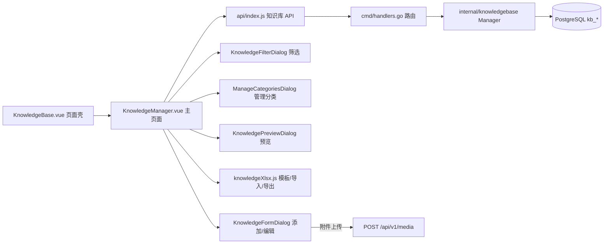

## 用户需求

在 libredesk 管理后台“渠道”分组中新增“客服知识库”菜单（紧挨“公共常用语”），实现完整的知识库管理功能，并配套设计数据库与编写后端代码。

## 产品概述

面向管理员/客服的知识条目管理系统：左侧两级分类树导航（含“全部分类”、默认“草稿”分类、“管理分类”入口），右侧知识条目列表（分页、预览、编辑、删除），支持 Excel 模板下载、批量导入、导出，以及带富文本编辑器和附件的添加/编辑知识弹窗、筛选排序弹窗。

## 核心功能

- **菜单与路由**：“渠道”分组下“公共常用语”之后新增“客服知识库”菜单项，注册对应路由与权限（`knowledge_base:manage`）
- **主页面**：左上“下载模板 / 导入知识 / 导出知识”按钮；右上“添加知识 / 筛选排序”按钮；左侧“« 全部分类”可折叠分类树（一级=知识库，二级=分类，含虚拟“草稿”节点）+ 底部“管理分类”链接；右侧知识列表（文档图标、【一级】【二级】标题、内容摘要、更新时间、“共N个结果”+分页），每条支持 预览/编辑/删除
- **下载模板**：按图2生成 xlsx 模板，6 列：分类Code、分类名、知识ID、知识Code、知识标题、知识作者，含填写说明行（分类Code必填；分类名按“一级/二级”结构自动创建；知识ID存在则更新、不存在则新增、同ID属多分类则无法导入；知识Code为第三方标识可空；标题≤50字；作者不限）
- **导入知识**：解析 xlsx → 提交后端按规则建分类/增改知识，逐行校验并展示错误结果
- **导出知识**：按模板列格式导出全部知识
- **添加/编辑知识弹窗**：标题、作者名称、两级联动分类选择（左列一级、右列二级，底部“选择结果”，发布时分类必填校验“不能为空”）、知识内容富文本编辑器（撤销/重做、加粗/斜体/下划线、链接、字号、字色/背景色、图片）、附件上传；底部“取消” + “确认”split 按钮（下拉：发布知识 / 预览 / 保存草稿）
- **筛选排序弹窗**：时间排序（倒序最新在前 / 顺序最早在前）、时间段（知识创建时间 + 不限/自定义范围）、关键词（范围：全部/标题/内容，多关键词空格分隔）；底部“清空筛选项 / 筛选查询”
- **管理分类弹窗**：左侧一级分类列表，右侧所选一级下的子分类（每行 修改/删除），支持“添加分类”（两级均可增改删），底部“确定”
- **数据库与后端**：设计分类表、知识表、附件关联表，编写 Go 后端模块与 REST API（分类树 CRUD、知识分页筛选查询与 CRUD、导入）

## 技术栈

- 前端：Vue3（现有 monorepo `frontend/apps/main`）+ vee-validate + zod + exceljs（复用 `cannedXlsx.js` 模式）+ 现有 TipTap `TextEditor.vue` 富文本组件
- 后端：Go + sqlx（PostgreSQL），参照 `internal/cannedresponse` 的 Manager + 内嵌预编译 queries 模式（无需 sqlc 代码生成）
- 数据库迁移：新增 `internal/migrations/v2.14.0.go`，注册到 `cmd/upgrade.go` 的 `migList`

## 实现方案

### 数据库设计（v2.14.0 迁移，全部幂等）

```sql
kb_categories (
  id BIGSERIAL PK, created_at, updated_at,
  parent_id BIGINT REFERENCES kb_categories(id) ON DELETE CASCADE,  -- 一级为 NULL
  code TEXT,           -- 分类Code，唯一
  name TEXT NOT NULL CHECK (length(name) <= 20),
  sort_order INT DEFAULT 0,
  UNIQUE (COALESCE(parent_id,0), name)
)
kb_articles (
  id BIGSERIAL PK, created_at, updated_at,
  category_id BIGINT REFERENCES kb_categories(id) ON DELETE SET NULL, -- 草稿可为空
  code TEXT,           -- 知识Code，唯一可空
  external_id TEXT,    -- 知识ID（导入增量标识，唯一）
  title TEXT NOT NULL CHECK (length(title) <= 50),
  author TEXT,
  content TEXT NOT NULL,             -- 富文本 HTML
  status TEXT NOT NULL DEFAULT 'published' CHECK (status IN ('published','draft')),
  INDEX on (category_id), INDEX on (status), INDEX on (created_at)
)
kb_article_attachments (
  id BIGSERIAL PK, article_id BIGINT REFERENCES kb_articles(id) ON DELETE CASCADE,
  media_uuid TEXT NOT NULL, file_name TEXT, content_type TEXT, size BIGINT
)
```

- 迁移内同步给 Admin 角色幂等追加权限 `knowledge_base:manage`（仿 v2.12.0 写法）
- “草稿”不建库表记录，为前端虚拟节点（按 `status='draft'` 查询）

### 后端 API（cmd/handlers.go 注册，统一 `perm(..., "knowledge_base:manage")`）

```
GET    /api/v1/kb/categories              分类树
POST   /api/v1/kb/categories              新增分类（含 parent_id）
PUT    /api/v1/kb/categories/{id}         重命名
DELETE /api/v1/kb/categories/{id}         删除（有子分类或关联知识则 4xx 拒绝）
GET    /api/v1/kb/articles                分页列表：category_id/status/sort(asc|desc)/date_from/date_to/keyword_field(all|title|content)/keywords/page/per_page，返回 {total, articles[](含分类名、摘要)}
GET    /api/v1/kb/articles/{id}           详情（含附件）
POST   /api/v1/kb/articles                新增（status=published|draft）
PUT    /api/v1/kb/articles/{id}           更新
DELETE /api/v1/kb/articles/{id}           删除
POST   /api/v1/kb/import                  导入（逐行事务处理，返回成功数+逐行错误）
```

- `internal/knowledgebase/` 新包：`models/models.go`（Category/Article/Attachment 结构）+ `knowledgebase.go`（Manager，预编译 SQL：树查询、筛选分页查询——关键词按 scope 拼 `title ILIKE ANY` / `content ILIKE ANY`，多关键词 OR；导入事务内按 code 查建分类、按 external_id upsert 知识）
- 权限：`internal/authz/models/models.go` 新增 `PermKnowledgeBaseManage` 常量并注册进权限 Map
- 附件复用现有 `POST /api/v1/media` 上传（返回 uuid），保存知识时随 payload 提交附件元数据落 `kb_article_attachments`，下载走现有 `/uploads/{uuid}`

### 前端

- `constants/navigation.js` 渠道分组 children 在 cannedResponses 项后插入 `{ titleKey: 'admin.knowledge.title', href: '/admin/knowledge-base', permission: 'knowledge_base:manage', icon: 'BookOpen' }`
- `router/index.js` 新增 `knowledge-base` 路由；`constants/permissions.js` 新增常量；`i18n/zh-CN.json`（其余语言文件补英文兜底键）
- `api/index.js` 追加知识库 API 封装并导出
- `views/admin/knowledge/KnowledgeBase.vue` 页面壳（面包屑）+ `features/admin/knowledge/` 下组件

## 架构



## 性能与可靠性

- 列表查询走 `category_id/status/created_at` 索引，分页用 `COUNT(*) OVER()` 或两次查询取 total
- 导入用单事务批量处理，逐行收集错误避免整体失败；标题/分类名长度校验前后端双重校验
- 删除分类采用"有关联数据拒绝删除"策略，避免知识被级联误删
- 沿用现有 Manager 预编译语句模式，不引入 sqlc 代码生成，控制改动半径

## 设计风格

延续 libredesk 现有管理后台视觉体系（浅灰蓝背景 + 白色卡片 + 蓝色主按钮），不引入新组件库，全部复用项目现有基础组件（BaseDialog、BaseButton、Input、Select、DropdownMenu 等）与 TipTap TextEditor。

- **主页面**：顶部工具栏左右分区（左：下载模板/导入知识/导出知识 带图标按钮；右：蓝色“添加知识”主按钮 + 带漏斗图标的“筛选排序”）；下方左右两栏——左栏 220px 白色卡片分类树（“« 全部分类”折叠头、两级树、选中项蓝色高亮、底部蓝色“管理分类”链接，虚拟“草稿”节点置顶）；右栏知识列表（每行文档图标 +【一级】【二级】标题 + 单行摘要 + 右侧“更新时间： …”，hover 出现 预览/编辑/删除 操作，底部“共N个结果”+ 分页器）
- **添加知识弹窗**：标题/作者/分类 左标签右控件布局；分类为两级联动双栏选择器（左一级列表、右二级列表、底部“选择结果 xxx”），校验失败红框+“不能为空”；知识内容为富文本编辑器；附件区为“+”上传块；底部“取消”+ 确认 split-button（下拉菜单：发布知识/预览/保存草稿）
- **筛选排序弹窗**：时间排序为两枚互斥切换按钮（选中蓝底白字）；时间段两个下拉；关键词为范围下拉+输入框；底部分隔线下“清空筛选项”与蓝色“筛选查询”
- **管理分类弹窗**：双栏布局，左侧一级分类列表（选中高亮），右侧子分类行（选中蓝底、行内 修改/删除 图标、Tooltip “修改”）+“添加分类”蓝色链接，底部右对齐“确定”

## Agent Extensions

### SubAgent

- **code-explorer**
- Purpose：实施前如需核对 canned 模块、TextEditor、BaseDialog 等现有组件的具体 props/事件签名，用其快速确认，避免凭记忆写错 API
- Expected outcome：获得可复用组件的准确接口签名，保证新组件与现有模式一致