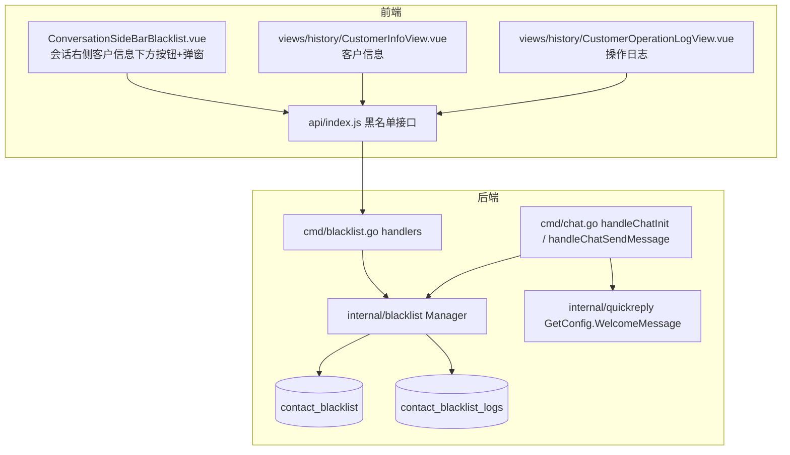

## 产品概述

在客服系统中新增「在线黑名单」能力，覆盖三个场景：会话侧把客户加入/移出黑名单、服务历史中新增「客户」菜单统一管理与审计、以及黑名单客户在访客端被静默拦截。

## 核心功能

1. 会话右侧客户信息面板黑名单操作

- 在客户信息区块下方展示一个操作按钮：客户已在黑名单内显示「移除在线黑名单」，否则显示「加入在线黑名单」。
- 点击「加入在线黑名单」弹出确认弹窗，含原因输入框与「取消 / 确认」按钮，提交后写入原因并提示操作成功。
- 点击「移除在线黑名单」弹出确认弹窗，仅含「取消 / 移除」按钮，确认后移出黑名单并提示成功。
- 操作完成后按钮文案立即切换为相反状态。

2. 服务历史新增「客户」菜单（与「在线客服」同级），含两个子菜单

- 客户信息：顶部 Tab「全部」与「在线黑名单」（在线黑名单 Tab 带数量徽标）；列表列为 客户昵称 / 操作人 / 操作时间 / 操作原因 / 操作，最右侧为「移除在线黑名单」操作，点击弹出仅「取消 / 移除」的确认弹窗；右上角提供「筛选排序」入口；支持分页。
- 操作日志：顶部 Tab「全部」；列表列为 操作时间 / 操作内容 / 操作人 / 昵称 / 操作原因；右上角提供「筛选排序」入口；支持分页。仅展示「加入/移除在线黑名单」相关操作记录。

3. 黑名单客户拦截

- 客户被拉黑后创建新会话时，系统仅自动回复欢迎语，不触发任何其他回复（自动回复、机器人、转人工、自动化、webhook 等）。
- 该会话不在客服后台会话列表中显示，也不生成服务历史会话记录（后台与服务历史均无痕）。

## 已确认约束

- 拦截粒度为「完全不落库」：不创建会话、不广播给客服、服务历史不留记录，仅即时回欢迎语。
- 「操作日志」仅展示黑名单相关操作（含操作人、昵称、操作原因）。
- 「客户信息」Tab 语义：「全部」= 所有客户列表；「在线黑名单」= 当前在黑名单中的客户，徽标数字为黑名单数量。
- 不设权限限制：任何登录坐席均可执行加入/移除操作。

## 技术栈

- 后端：Go（沿用现有 fastglue + sqlx + PostgreSQL 架构）、sqlc 风格 `queries.sql` + `dbutil.ScanSQLFile` 预编译查询、koanf 配置
- 前端：Vue 3 + Vite + Pinia + vue-i18n + Tailwind CSS + `@shared-ui`（shadcn 风格组件）+ `lucide-vue-next` 图标
- 数据库：PostgreSQL，新增表通过 `internal/migrations` 版本化迁移

## 实现方案

### 整体策略

新增独立的 `internal/blacklist` 领域模块（与 `internal/activity_log` 同构），用两张表承载「黑名单状态」与「黑名单操作日志」；前端新增一个客户信息按钮组件 + 两个服务历史视图页；后端在访客会话初始化与消息发送入口插入黑名单拦截，使黑名单客户的会话完全不落库，仅回显欢迎语。

### 关键技术决策

1. **独立黑名单表而非复用 `users.enabled=false`**
现有「屏蔽联系人」(`PUT /api/v1/contacts/{id}/block`) 语义是全局禁用且仅邮件渠道生效，与「在线黑名单」语义不同；且新需求需要记录 操作人 / 操作时间 / 操作原因。复用会污染既有语义且无法存原因。因此新建：

- `contact_blacklist`：黑名单状态（contact_id 唯一、reason、created_by、created_at）
- `contact_blacklist_logs`：黑名单操作日志（contact_id、action=add/remove、reason、actor_id、created_at）
对现有 `contacts/{id}/block` 零影响。

2. **操作日志用独立表而非改造 `activity_logs`**
用户确认只需黑名单相关操作。改造 `activity_logs` 需 `ALTER TYPE activity_log_type ADD VALUE` 且要新增 `reason` 列（影响现有 admin 操作日志页与 `GetAll` 过滤逻辑）。独立表改动面小、字段语义直接匹配截图列（操作时间/操作内容/操作人/昵称/操作原因）。

3. **「完全不落库」拦截点**

- 主拦截点：`cmd/chat.go` 的 `handleChatInit`。在解析出 `contactID` 之后、`GetContactChatConversations`/`CreateConversation` 之前查询黑名单；命中则**跳过**会话复用、会话创建、`InsertMessage`、`ProcessIncomingMessageHooks`、`BroadcastNewConversation`，直接读取该 inbox 的欢迎语配置（`internal/quickreply` 的 `GetConfig(inboxID).WelcomeMessage`）构造一条**不持久化**的消息回给访客端。
- 次拦截点：`cmd/chat.go` 的 `handleChatSendMessage`。命中黑名单时同样不持久化、不广播，仅返回欢迎语。
- 说明：欢迎语文本与现有逻辑同源（`inbox_quick_reply_configs.welcome_message`），保证文案一致；因无会话 uuid，不走 `SendAutoReply`，而是在响应中直接返回消息体。

4. **访客端（widget）兼容**
为避免 widget 因缺少 conversation uuid 而报错，黑名单分支的 init 响应仍返回 `conversation: null` + `messages: [欢迎语]` + `blacklisted: true`。实现时需核对 `widget-frontend` 对 init 响应的消费方式，保证欢迎语可正常展示；若 widget 强依赖 uuid，则退化为返回只读的临时壳对象（不落库），不创建真实会话。

5. **黑名单状态查询**
新增 `GET /api/v1/blacklist/contacts/{contactID}` 返回该客户是否在黑名单，供会话右侧面板按 `conversationStore.current.contact.id` 查询并在操作成功后本地刷新。

### 性能与可靠性

- 黑名单判定在访客会话初始化/发消息热路径上，单次主键查询开销极低；可在 Manager 内做进程内短 TTL 缓存（`contact_id -> bool`，写入时失效）以进一步降低查询压力；若不加缓存也完全可接受，遵循 KISS 优先。
- 客户信息/操作日志列表统一走分页 SQL（`LIMIT/OFFSET` + `COUNT(*) OVER()` 或既有 `Total` 写法），并加索引：`contact_blacklist(contact_id)` 唯一、`contact_blacklist_logs(created_at DESC)`、`contact_blacklist_logs(contact_id)`。避免全表扫描。
- 列表 SQL 用 `LEFT JOIN users` 一次性取回昵称与操作人姓名，杜绝 N+1。

### 避坑与兼容性

- 不改动 `internal/activity_log`、不改 `users.enabled` 语义、不改现有 `contacts/{id}/block`。
- 新迁移必须注册到 `cmd/upgrade.go` 的 `migList`，且 SQL 幂等。
- 端点按用户确认**只做登录校验**，不加 `perm` 包装；前端菜单项不加 `permission` 字段。
- 日志使用模块自带 `*logf.Logger`，记录关键操作（contact_id、actor_id、action），不输出原因明文以外的敏感信息。

## 架构设计



- 数据层：`contact_blacklist`（当前状态，移除即删除行）+ `contact_blacklist_logs`（全量操作流水）
- 服务层：`internal/blacklist` 提供 `IsBlocked`、`Add`、`Remove`、`GetContactBlacklist`、`GetCustomers`、`GetLogs`
- 接口层：`cmd/blacklist.go` + `cmd/handlers.go` 注册路由
- 拦截层：`cmd/chat.go` 两个访客入口
- 展示层：会话侧栏组件 + 服务历史两个新视图页

## 目录结构

```
e:/libredesk/
├── internal/
│   ├── blacklist/
│   │   ├── blacklist.go          # [NEW] Manager：New(Opts)、IsBlocked(contactID)、Add(contactID, reason, actorID)、Remove(contactID, actorID)、GetContactBlacklist(contactID)、GetCustomers(...) 全部/仅黑名单分页查询、GetLogs(...) 操作日志分页查询。沿用 activity_log 的 queries 预编译风格与 envelope 错误返回
│   │   ├── models/models.go      # [NEW] Blacklist、BlacklistEntry、BlacklistLog、CustomerBlacklistRow 等结构体 + add/remove 动作常量
│   │   └── queries.sql           # [NEW] is-blocked / get-contact-blacklist / insert-blacklist / delete-blacklist / get-customers / count-blacklist / get-logs / insert-log
│   └── migrations/
│       └── v2.15.0.go            # [NEW] 建 contact_blacklist 与 contact_blacklist_logs 表及索引，SQL 幂等
├── cmd/
│   ├── main.go                   # [MODIFY] App 结构体新增 blacklist 字段并初始化
│   ├── upgrade.go                # [MODIFY] migList 注册 v2.15.0
│   ├── handlers.go               # [MODIFY] 注册黑名单相关路由（仅 auth 包装，不加 perm）
│   ├── blacklist.go              # [NEW] handleAddBlacklist / handleRemoveBlacklist / handleGetContactBlacklist / handleGetBlacklistCustomers / handleGetBlacklistLogs
│   └── chat.go                   # [MODIFY] handleChatInit 与 handleChatSendMessage 加入黑名单拦截与仅回欢迎语分支
├── frontend/apps/main/src/
│   ├── api/index.js              # [MODIFY] 新增 addBlacklist / removeBlacklist / getContactBlacklist / getBlacklistCustomers / getBlacklistLogs 并加入默认导出
│   ├── constants/navigation.js   # [MODIFY] historyNavItems 新增与「在线客服」同级的「客户」菜单及「客户信息」「操作日志」两个子菜单
│   ├── router/index.js           # [MODIFY] /history 下新增 customer-info 与 customer-operation-log 两个子路由
│   ├── features/conversation/sidebar/
│   │   └── ConversationSideBarBlacklist.vue  # [NEW] 黑名单操作按钮 + 加入（带原因输入框）/移除确认弹窗，根据当前会话联系人 id 查询状态并在操作后翻转
│   ├── features/conversation/sidebar/
│   │   └── ConversationSideBar.vue           # [MODIFY] 在 details Tab 的 ConversationSideBarContact 之后挂载黑名单组件
│   ├── features/history/
│   │   ├── CustomerInfoTable.vue             # [NEW] 客户信息列表表格（列：客户昵称/操作人/操作时间/操作原因/操作）
│   │   ├── CustomerInfoFilters.vue           # [NEW] 客户信息「筛选排序」面板
│   │   └── CustomerOperationLogTable.vue     # [NEW] 操作日志列表表格（列：操作时间/操作内容/操作人/昵称/操作原因）
│   └── views/history/
│       ├── CustomerInfoView.vue              # [NEW] 客户信息页：Tab（全部/在线黑名单带徽标）+ 筛选排序 + 列表 + 移除确认弹窗
│       └── CustomerOperationLogView.vue      # [NEW] 操作日志页：Tab + 筛选排序 + 列表
└── i18n/
    ├── en-US.json                 # [MODIFY] 新增黑名单相关文案键
    └── zh-CN.json                 # [MODIFY] 新增黑名单相关中文文案（按需求措辞）
```

## 关键数据结构

```
-- 黑名单状态（移除时删除行）
contact_blacklist: id, contact_id (unique, FK users), reason, created_by, created_at
-- 黑名单操作日志（加入/移除均留痕）
contact_blacklist_logs: id, contact_id (FK users), action ('add'|'remove'), reason, actor_id, created_at
```

Manager 对外方法（接口级，不含实现）：

```
func (m *Manager) IsBlocked(contactID int) (bool, error)
func (m *Manager) Add(contactID, actorID int, reason string) error
func (m *Manager) Remove(contactID, actorID int) error
func (m *Manager) GetCustomers(order, orderBy, search string, onlyBlocked bool, page, pageSize int) ([]models.CustomerRow, int, error)
func (m *Manager) GetLogs(order, orderBy, search string, page, pageSize int) ([]models.BlacklistLogRow, int, error)
```

## 设计风格

沿用 LibreDesk 后台既有的企业级简洁风格（浅色卡片 + 中性灰底 + 单一品牌色强调），保证新页面与「会话记录」「联系人」等既有页面视觉一致，不引入新的设计语言。

## 页面一：客户信息（服务历史 > 客户 > 客户信息）

1. 顶部标题区：左侧页面标题「客户信息」与总数说明，右上角「筛选排序」按钮（outline 样式，带 Filter 图标，激活时主色描边）。
2. Tab 区：「全部」与「在线黑名单」两个 Tab，「在线黑名单」右侧带数字徽章（展示当前黑名单客户数量），切换即重新拉取列表。
3. 列表表格：列依次为 客户昵称 / 操作人 / 操作时间 / 操作原因 / 操作；昵称列带圆形头像与名称；未拉黑客户的操作人、操作时间、操作原因三列显示占位符「-」；操作列仅在客户处于黑名单时显示「移除在线黑名单」图标按钮（Trash2 图标，hover 变红并出现 tooltip）。
4. 底部：分页/加载更多控件，空态展示居中提示文案。
5. 移除确认弹窗：居中 Dialog，标题「移除在线黑名单」，正文提示确认文案，底部右对齐「取消」与「移除」两个按钮，「移除」为 destructive 主色。

## 页面二：操作日志（服务历史 > 客户 > 操作日志）

1. 顶部标题区：左侧标题「操作日志」，右上角「筛选排序」按钮。
2. Tab 区：单 Tab「全部」。
3. 列表表格：列依次为 操作时间 / 操作内容 / 操作人 / 昵称 / 操作原因；操作内容展示「加入在线黑名单」或「移除在线黑名单」文案，可用不同色标签区分（加入为中性/警示色，移除为成功色）。
4. 底部：分页控件与空态提示。

## 会话右侧面板新增区块

在客户信息卡片下方增加一行高 36px 的按钮区：未拉黑显示「加入在线黑名单」（ShieldOff 图标 + outline 按钮），已拉黑显示「移除在线黑名单」（ShieldCheck 图标 + 危险态 outline 按钮），宽度撑满内容区。

- 加入弹窗：Dialog 标题「加入在线黑名单」，中部为「操作原因」标签 + Textarea（必填，placeholder 提示填写原因），底部右对齐「取消」与「确认」，「确认」为主色实心按钮，原因为空时禁用。
- 移除弹窗：Dialog 标题「移除在线黑名单」，纯确认文案，底部右对齐「取消」与「移除」。
- 交互：按钮 hover 有背景微变化；操作进行中按钮显示 loading 态；成功后 toast 提示并即时切换按钮文案。

## 侧边栏菜单

服务历史分组下新增「客户」分组项（User 图标），展开后为「客户信息」（Contact 图标）与「操作日志」（History 图标），与既有「在线客服」分组同级，层级与图标风格保持一致。

## 响应式与动效

列表在窄屏下横向滚动保持列完整；弹窗与列表切换使用项目既有的轻量过渡，不引入额外动画库。

## Agent Extensions

### SubAgent

- **code-explorer**
- Purpose：在实现黑名单拦截与前端接线前，精确勘察 `cmd/chat.go` 的 init/发消息响应结构、`widget-frontend` 对 init 响应的消费方式、以及 `internal/user/queries.sql` 与 `dbutil.ScanSQLFile` 的查询写法约定，避免猜测 API。
- Expected outcome：拿到可直接照搬的 handler 响应构造方式、widget 端字段依赖清单、以及新增 `internal/blacklist/queries.sql` 所需的 SQL 书写与预编译规范。