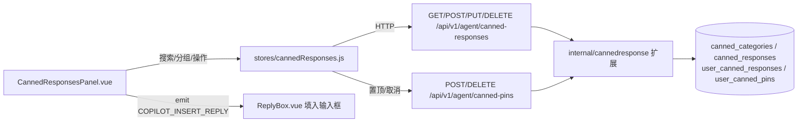

## 产品概述

在会话侧边栏（Details / Juno 两个 Tab）的 Juno 右侧紧挨着新增一个"常用语"Tab，为客服提供快捷回复面板。面板内展示"置顶常用语"、"个人常用语"以及从"公共常用语"同步过来的各分类常用语，支持搜索、点击自动填入回复输入框。

## 核心功能

- **Tab 入口**：在会话侧边栏新增第三个 Tab"常用语"，与 Details、Juno 并列
- **搜索**：面板顶部提供搜索框，按内容过滤所有分组的常用语
- **分组展示**：默认分组为"置顶常用语"和"个人常用语"，其余分组自动同步自管理员维护的"公共常用语"分类树
- **个人常用语管理**：支持新增、编辑、删除、置顶；分组标题右侧提供新增入口，条目 hover 显示置顶/编辑/删除操作
- **置顶管理**：置顶常用语分组内的条目可"取消置顶"；公共常用语条目仅提供"置顶"操作
- **一键填入**：点击任意常用语条目，自动填入回复输入框，客服确认后点击发送即可

## 技术栈

- 后端：Go（现有架构：internal 模块包 + cmd 层 handlers + SQL 嵌入式查询 + PostgreSQL 迁移）
- 前端：Vue 3 + 现有 shadcn 风格组件库（@shared-ui/components/ui）+ Pinia + mitt 事件总线
- 数据库：PostgreSQL，新增两张表并通过版本迁移落地

## 实现方案

### 数据模型（迁移 internal/migrations/v2.13.0.go，参照 v2.12.0.go 模式，并同步更新 schema.sql）

- `user_canned_responses`：个人常用语（id、user_id 外键 users ON DELETE CASCADE、content CHECK ≤1000 字符、sort_order、时间戳）
- `user_canned_pins`：置顶记录（user_id、source ∈ ('global','personal')、response_id、sort_order，UNIQUE(user_id, source, response_id)；不设跨表外键，由聚合视图过滤已失效引用；删除个人常用语时同步清理其置顶记录）

### 后端服务层（扩展 internal/cannedresponse 包，queries.sql 增加客服级语句）

- `GetAgentView(userID)`：两次查询 + 内存组装，返回 { pinned[]（解析后的内容与来源）, personal[], globalTree[] }，复用现有 GetTree 组装逻辑，避免 N+1
- `CreatePersonal/UpdatePersonal/DeletePersonal(userID, ...)`：全部带 user_id 作用域校验，防止越权改删他人数据
- `Pin/Unpin(userID, source, id)`：置顶时校验目标存在；Unpin 幂等

### 后端接口层（cmd/cannedresponse.go 新增 handlers，cmd/handlers.go 注册路由）

- `GET /api/v1/agent/canned-responses`：返回聚合视图（权限 `messages:write`，普通客服可用，绕开仅管理员持有的 `canned_responses:manage`）
- `POST /api/v1/agent/canned-responses`：新增个人常用语
- `PUT/DELETE /api/v1/agent/canned-responses/{id}`：编辑/删除个人常用语（仅限本人）
- `POST/DELETE /api/v1/agent/canned-pins/{source}/{id}`：置顶/取消置顶
- 复用 envelope 错误封装与 i18n 文案；新增 en-US.json / zh-CN.json 键（如 `conversation.cannedResponses.*`）

### 前端

- `api/index.js`：新增 4 个接口封装（沿用现有写法）
- `stores/cannedResponses.js`（新建 Pinia store）：按 user 缓存聚合数据，面板切换 Tab 时不重复请求，操作后本地更新
- `CannedResponsesPanel.vue`（新建）：搜索框（本地 computed 过滤，无后端压力）+ Accordion 分组（置顶常用语、各公共分类、个人常用语，默认展开"个人常用语"）；条目 hover 显示操作图标（Pin/PinOff/Edit/Trash）；点击条目 `emitter.emit(EMITTER_EVENTS.COPILOT_INSERT_REPLY, content)`，复用 ReplyBox.vue 已有监听，将内容填入回复框（private_note 状态自动切回 reply，已有逻辑）
- `ConversationSideBar.vue`：TabsList 改 `grid-cols-3`，新增 TabsTrigger value="canned" 与 TabsContent

## 架构图

## 性能与可靠性

- 聚合视图固定 3~4 条 SQL，内存组装，无 N+1；搜索为前端内存过滤，数据量级（公共+个人 ≤ 数千条）无性能瓶颈
- 内容长度沿用 1000 字符约束，前后端双重校验；个人数据全部按 user_id 作用域隔离，防越权
- 置顶引用公共常用语被管理员删除后，聚合视图自动过滤失效引用，不报错

## 设计风格

沿用会话侧边栏现有设计语言（shadcn 风格 + Tailwind 语义色 token），与 Details/Juno Tab 及 CopilotPanel 保持一致，不做突兀的新风格。

## 布局结构

- **Tab 栏**：TabsList 由两栏改为三栏（grid-cols-3），新增"常用语"TabsTrigger，样式 text-xs 与现有一致
- **搜索区**：顶部圆角搜索输入框（Search 图标 + "搜索常用语..." 占位符），右侧留空或放排序图标位
- **分组列表**：使用 Accordion 组件，分组依次为"置顶常用语"、"个人常用语"、各公共分类（与公共常用语分类树一致）；置顶/个人分组固定在最前；"个人常用语"标题右侧显示 + （新增）图标
- **条目行**：单行文本截断（truncate），hover 高亮背景并在行尾显示操作小图标（置顶 Pin / 取消置顶 PinOff / 编辑 Pencil / 删除 Trash，h-3.5 尺寸 ghost button）；点击条目主体即填入回复框
- **交互反馈**：操作成功/失败通过现有 SHOW_TOAST 事件提示；空分组显示占位文案；搜索无结果显示"未找到匹配的常用语"
- **响应式**：面板在侧边栏固定宽度内自适应，列表区 flex-1 overflow-y-auto 独立滚动，输入区常驻