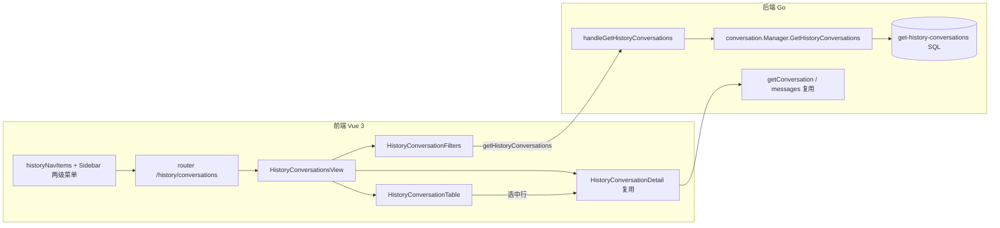

## Product Overview

在现有客服系统主菜单“历史”下按参考图重构子菜单层级，并新增“会话记录”功能页：左侧二级导航形成“历史 > 在线客服 > {会话记录, 搜索}”三级结构；点击“会话记录”进入列表页，按访客维度查看历史会话，并支持筛选排序与内联查看聊天记录。

## Core Features

- 菜单层级重构：主菜单“历史”展开后显示子菜单“在线客服”，“在线客服”再展开为“会话记录”“搜索”两个子菜单（顺位：会话记录在前，搜索在后），保留原有“搜索”能力不变。
- 会话记录列表：标题栏显示“会话记录”，右上角提供主操作按钮与“筛选排序”按钮；表格至少包含“访客昵称”“最后接待客服”“接起时间”三列（每行带访客头像），并补充状态、渠道/收件箱、会话编号等辅助列。
- 筛选排序面板（右侧内联）：
- 时间排序：分段按钮“时间倒序(最新在前)”/“时间顺序(最早在前)”，选中态高亮。
- 时间段：维度下拉（“会话接起时间”）+ 期间下拉（今天/昨天/本周/本月/上月/指定时间）+ 区间文本（如“2026/10/11 00:00:00 至 2026/10/17 23:59:59”），选“指定时间”时可输入起止时刻。
- 访客ID：文本输入框（placeholder“访客ID”），按访客外部ID精确筛选。
- 底部：“清空筛选项”文字按钮（左）+“筛选查询”主按钮（右）。
- 会话详情内联展示：点击表格某行，右侧面板切换为会话详情，展示聊天记录（发言人、时间、消息气泡）与用户信息（昵称、邮箱、手机号、访客ID 等）；再次点击“筛选排序”回到筛选面板；中间提供可拖拽分隔条。
- 数据真实性：访客昵称取自会话联系人，最后接待客服取会话负责人姓名，接起时间取首次回复时间；时间筛选与排序均作用于“接起时间”。
- 状态处理：列表加载态、空结果提示、请求失败提示与重试。

## Tech Stack

- 前端：Vue 3 + `<script setup>` + Tailwind CSS + shadcn-vue 组件（项目 `@shared-ui` 已提供 Select/Input/Button/ComboBox/Avatar/Spinner 等），vue-i18n 文案。
- 后端：Go（libredesk，fastglue + sqlx），PostgreSQL，查询用 `queries.sql` + `sqlx` 命名查询。
- 保持既有技术栈，不引入新框架/依赖。

## Implementation Approach

- 菜单：`historyNavItems` 由“历史 > 搜索”升级为“历史 > 在线客服 > {会话记录, 搜索}”；`Sidebar.vue` 的历史二级导航由单层 `Collapsible + SidebarMenuSub` 扩展为两层嵌套（复用现有组件与激活态判定 `isActiveParent`，`filterNavItems` 递归过滤已可兼容）。
- 路由：在现有 `/history` children 中新增 `conversations`，复用 `hidePageHeader` 模式（同 `history-search`），并将 `/history` 默认跳转指向“会话记录”。
- 页面：新建 `HistoryConversationsView.vue`，整体沿用 `HistorySearchView.vue` 的布局骨架（标题栏 + 主体 + 右侧栏切换 + 可拖拽 splitter + 常量 RIGHT_WIDTH_MIN/MAX/DEFAULT）。
- 后端：新增专用只读接口 `GET /api/v1/history/conversations`，避免改动 inbox 通用列表查询（`get-conversations`）造成大面积影响：
- 新增 SQL `get-history-conversations`：`conversations` JOIN 联系人 `users ct`、负责人 `users au`、`inboxes`、`conversation_statuses`，返回访客昵称/头像/`external_user_id`、最后接待客服姓名、`first_reply_at`（接起时间）、状态、收件箱、会话编号等；可选参数采用跳过式（`$n IS NULL OR ...`）实现“未设置即不过滤”。
- 时间维度作用于 `first_reply_at`；`visitor_id` 对 `ct.external_user_id` 做精确匹配（可为空 → 不过滤）；排序按 `first_reply_at` 升/降序；分页沿用 `envelope.PageResults`。
- handler 复用 `cmd/search.go` 的 `resolvePeriod` 解析 `today/yesterday/this_week/this_month/last_month/custom`。
- 详情面板复用既有 `getConversation` + `getConversationMessages`，无需新详情接口。
- 关键决策与理由：不扩展现有 `/conversations/all` 的 `ConversationListItem`（其被 inbox 全量列表复用，新增负责人姓名 join 会波及所有列表页），改用低耦合的专用接口，满足“访客ID筛选 + 客服姓名 + 接起时间”真实可用，回滚成本低。
- 性能：列表查询单次 JOIN + 分页 LIMIT/OFFSET，复杂度 O(log n + page_size)；`first_reply_at`、`users.external_user_id` 若已有索引可直接命中，否则按需评估（默认不新增索引，避免迁移噪声）。前端列表分页加载，详情面板按需加载消息；请求带 `abortOnRoute`，筛选变更用 requestId 丢弃过期响应（复用现有搜索页模式）。

## Implementation Notes

- 复用现有模式：i18n 在仓库根 `i18n/zh-CN.json`、`en-US.json`（前端动态加载），新增 key 需中英各补一份。
- 保留“搜索”页面与路由不动，仅调整菜单层级与 `/history` 默认跳转；不改 `globals.terms.serviceHistory`（“服务历史”侧边栏标题已是期望文案）。
- 后端权限沿用 `conversations:read`（与 `/conversations/search` 一致），不新增权限项。
- 日志沿用项目 `logf` 风格，错误仅记录必要上下文，避免输出访客隐私字段（邮箱/手机号）于日志中。
- 表头文案与筛选面板文案严格对齐参考图（“访客昵称/最后接待客服/接起时间/访客ID/清空筛选项/筛选查询/筛选排序项/时间倒序(最新在前)/时间顺序(最早在前)/时间段/会话接起时间”）。
- 空值与边界：无 `first_reply_at` 的会话在按时间段筛选时排除；筛选输入非法时间段（结束早于开始）给出提示；`visitor_id` 去除首尾空格。

## Architecture Design



## Directory Structure

```
libredesk/
├── cmd/
│   ├── history_conversations.go   # [NEW] handleGetHistoryConversations：解析 page/page_size/order/period/start/end/visitor_id，调用 Manager，复用 resolvePeriod，返回 PageResults 信封
│   └── handlers.go                # [MODIFY] 注册 GET /api/v1/history/conversations（perm conversations:read）
├── internal/conversation/
│   ├── queries.sql                # [MODIFY] 新增 -- name: get-history-conversations 查询（联系人/负责人/收件箱 JOIN + 跳过式过滤 + 按 first_reply_at 排序分页）
│   ├── models/models.go           # [MODIFY] 新增 HistoryConversationItem（uuid/reference_number/created_at/first_reply_at/status/inbox_*/contact{...}/assigned_user 姓名）
│   └── conversation.go            # [MODIFY] queries 结构体新增 GetHistoryConversations 字段 + Manager.GetHistoryConversations 方法（组装 existingArgs/order/分页，复用 dbutil 分页思路）
├── frontend/apps/main/src/
│   ├── constants/navigation.js    # [MODIFY] historyNavItems 改为 历史 > 在线客服 > {会话记录 /history/conversations, 搜索 /history/search}
│   ├── components/sidebar/Sidebar.vue      # [MODIFY] 历史二级导航支持两层嵌套 Collapsible（在线客服为父、会话记录/搜索为子），保留 isActiveParent 激活态
│   ├── router/index.js            # [MODIFY] /history children 新增 conversations（name: history-conversations），redirect 指向 /history/conversations
│   ├── api/index.js               # [MODIFY] 新增 getHistoryConversations(params) => GET /api/v1/history/conversations
│   ├── views/history/HistoryConversationsView.vue   # [NEW] 会话记录页容器：标题栏+操作区、表格区、右侧栏（筛选/详情）切换、splitter、加载/空/错误态、requestId 防竞态
│   └── features/history/
│       ├── HistoryConversationTable.vue     # [NEW] 表格：访客头像+昵称 / 最后接待客服 / 接起时间 /（状态、渠道、编号），行点击 emit select
│       ├── HistoryConversationFilters.vue   # [NEW] 筛选排序面板：时间排序分段按钮、时间段（维度+期间+区间显示+自定义时间）、访客ID 输入、清空/筛选查询
│       ├── HistoryConversationDetail.vue    # [MODIFY]（可选增强）新增可选 row 属性，在用户信息区补充“最后接待客服/接起时间”，聊天记录逻辑不变
│       ├── searchParams.js        # [MODIFY] 新增 buildConversationsParams（period/start/end/visitorId/order/page）与维度常量
│       └── HistorySearchFilters.vue # [参考] 复用其 period→start/end 解析与样式体系，不改动
└── i18n/
    ├── zh-CN.json                 # [MODIFY] 新增 在线客服/会话记录/访客昵称/最后接待客服/接起时间/访客ID/清空筛选项/筛选查询/时间维度 等 key
    └── en-US.json                 # [MODIFY] 同步英文 key
```

## Key Code Structures

```
// internal/conversation/models/models.go
type HistoryConversationItem struct {
    Total           int             `db:"total" json:"-"`
    UUID            string          `db:"uuid" json:"uuid"`
    ReferenceNumber string          `db:"reference_number" json:"reference_number"`
    CreatedAt       time.Time       `db:"created_at" json:"created_at"`
    FirstReplyAt    null.Time       `db:"first_reply_at" json:"first_reply_at"` // 接起时间
    Status          null.String     `db:"status" json:"status"`
    InboxName       string          `db:"inbox_name" json:"inbox_name"`
    InboxChannel    string          `db:"inbox_channel" json:"inbox_channel"`
    Contact         ConversationListContact `db:"contact" json:"contact"` // 含 external_user_id / first_name / last_name / avatar_url
    AssignedUserName null.String    `db:"assigned_user_name" json:"assigned_user_name"` // 最后接待客服
}

// cmd/history_conversations.go —— 查询契约
// GET /api/v1/history/conversations
//   page, page_size, order=asc|desc, period=today|yesterday|this_week|this_month|last_month|custom|all,
//   start, end (period=custom 时), visitor_id (external_user_id, 精确匹配, 可空)
```

## Validation

- 后端：构造带 `period`/`visitor_id` 的请求验证过滤生效、分页与排序正确；空参数时不报错。
- 前端：菜单三级展开/激活态正确、路由跳转正确；列表字段与参考图一致；筛选面板各项可用；点击行右侧展示聊天记录与用户信息。

## Design Style

沿用项目既有后台设计语言（shadcn-vue + Tailwind，hsl CSS 变量令牌），保持色彩、圆角、边框、间距与“搜索”页完全一致，不引入新的视觉体系。整体呈现专业、克制、信息密度高的客服工作台观感：浅色卡片面板 + 细边框 + 蓝色主色强调操作。

## Layout

- 二级侧边栏：标题“服务历史”；“历史”折叠项下嵌套“在线客服”折叠项，再缩进展示“会话记录”“搜索”，当前项以主色高亮、左侧竖条指示。
- 列表页：顶部标题栏左侧显示“会话记录”，右侧放置主操作按钮与“筛选排序”按钮（漏斗图标）；主体为带自适应列宽的表格，行 hover 高亮，选中行以主色浅底标识；行首为访客头像 + 昵称。
- 右侧面板：默认收起，点击“筛选排序”后从右侧滑入筛选面板，点击表格行切换为会话详情面板；面板与主体之间为可拖拽竖向分隔条，宽度记忆于会话内（360–960px）。
- 筛选面板：顶部“筛选排序项”标题 + 折叠按钮；【时间排序】两个等宽分段按钮；【时间段】两行下拉 + 区间文本；【访客ID】单行输入；底部左侧文字型“清空筛选项”、右侧主色“筛选查询”。
- 详情面板：顶部昵称 + 会话编号/状态 + 关闭按钮；左侧聊天记录区（联系人消息左对齐灰底、客服消息右对齐主色底、居中时间分隔）；右侧窄栏为访客信息（头像、邮箱、手机号、访客ID、接起时间、最后接待客服）。

## Interaction

- 分段按钮/下拉/折叠项均有 150–200ms 过渡；表格行 hover 有背景与轻微抬升反馈；分隔条 hover 变主色。
- 加载显示居中 Spinner；无数据显示居中文案；失败显示错误信息 + 重试按钮。
- 键盘可达：筛选控件支持 Tab 顺序与 Enter 提交；表格行可聚焦并可用 Enter 打开详情；“筛选排序”按钮有 aria-expanded/aria-controls。

## Responsiveness

- 桌面优先（主侧边栏 + 二级侧边栏 + 内容区三栏）。内容区在窄屏下隐藏右侧面板默认展开状态，改为覆盖式抽屉；表格在窄屏下横向滚动，关键三列固定靠左显示。

## Agent Extensions

### Skill

- **lsp-code-analysis**
- Purpose: 对菜单与路由改动做影响分析（`historyNavItems`、`filterNavItems`、`Sidebar.vue`、`isActiveParent` 的引用与调用链），确认两级嵌套改造不会破坏其它菜单与激活态。
- Expected outcome: 输出受影响符号清单与调用点，验证改动范围边界，避免遗漏渲染分支。
- **accessibility-auditor**
- Purpose: 审查新增“会话记录”页面与筛选面板的键盘可达性、ARIA 语义与可聚焦表格行，确保符合 WCAG 2.2 基本要求。
- Expected outcome: 产出可执行的修复清单（焦点顺序、aria-expanded/aria-controls、表格语义、对比度），并在实现中落实。