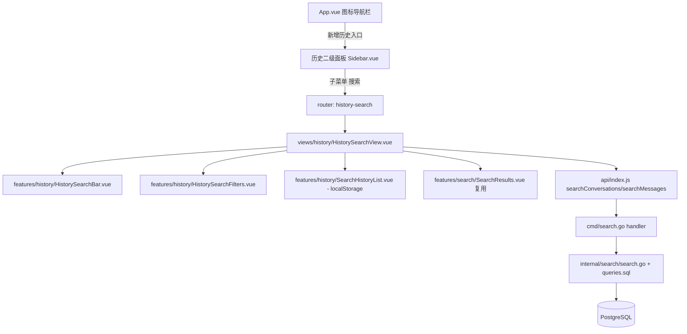

## Product Overview

在 LibreDesk 后台侧边栏"联系人"与"报告"之间新增一级导航「历史」，其下包含子菜单「搜索」。用户可在该搜索页输入关键词，按时间排序、时间段、收件箱、客服四个维度筛选，并复用现有会话/消息搜索接口返回结果。搜索框下方展示本机保存的「历史搜索记录」，点击可快速再次搜索。

## Core Features

- **侧边栏新增「历史」菜单**：位于一级图标导航栏"联系人"与"报告"之间，点击进入后展开二级面板（标题「服务历史」），内含可折叠的「历史」一级菜单及其子菜单「搜索」（默认选中态）。
- **历史搜索页面**：
- 顶部标题「搜索」；下方一行包含搜索输入框（占位"请输入搜索内容"）、搜索按钮（蓝色）、带漏斗图标的「筛选排序」按钮。
- 搜索框下方为「历史搜索记录」区块，以列表形式展示最近搜索词（本地保存，可清空/点击复用）。
- 右侧为「筛选排序项」面板（可折叠/收起）。
- **筛选排序面板**：
- 时间排序：两个并排切换按钮「时间排序(最新在前)」/「时间排序(最旧在前)」，选中态为蓝底白字。
- 时间段：下拉选择「今天/昨天/本周/本月/上月/指定时间」（选中项蓝底白字）；选择后展示对应起止时间（如 2026/10/01 00:00:00 至 2026/10/01 23:59:59），"指定时间"可选自定义起止。
- 收件箱：收件箱多选列表，每项含圆形图标/头像 + 名称 + 右侧删除图标，已选项展示为可移除标签。
- 客服：下拉选择，默认「全部客服」。
- 底部：「清除筛选项」（文字按钮）与「筛选应用」（蓝色主按钮）。
- **搜索与结果**：应用筛选条件后调用搜索接口（会话 + 消息）展示结果；搜索词写入历史记录；最少 3 字符、输入防抖。

## Note

本次不包含筛选面板中的「发送方」维度；历史搜索记录仅本地保存，不需要后端存储。

## Tech Stack

沿用现有技术栈，不引入新框架：

- 前端：Vue 3 + Vite + Tailwind CSS + shadcn-vue（共享包 `@shared-ui/components`），图标使用 `lucide-vue-next`，状态管理 Pinia（setup store 风格）。
- 后端：Go + fastglue + sqlx（PostgreSQL），搜索逻辑位于 `internal/search`。
- i18n：翻译源文件位于 Go 后端 `i18n/*.json`，前端启动时通过 `GET /api/v1/lang/:lang` 拉取。

## Implementation Approach

1. **导航接入（复用现有模式）**：

- 在 `constants/navigation.js` 新增 `historyNavItems`，结构参考 `adminNavItems` 的 `children` 折叠格式：一级项 `titleKey: 'globals.terms.history'` + `icon: 'History'`，子项 `titleKey: 'globals.terms.search'` + `href: '/history/search'`。
- 在 `App.vue` 一级图标栏中，于"联系人"项之后、"报告"项之前插入「历史」入口（`router-link` → `{ name: 'history-search' }`），图标来自 lucide（如 `History`）。
- 在 `Sidebar.vue` 中新增「历史」二级侧边栏面板（参考报告/管理面板）：显示判据用 `route.matched.some(r => r.name && r.name.startsWith('history'))`，头部标题 `t('globals.terms.history')`，内部对带 `children` 的项复用 `Collapsible` + `SidebarMenuSub` 折叠渲染，`navIconMap` 增加 `History` 图标映射，并新增 `openHistoryCollapsible` 状态与随路由自动展开的 `watch`（参考 `openAdminCollapsible`）。
- 在 `router/index.js` 根路由 children 中新增 `history` 分支，`name` 以 `history` 前缀命名（如 `history-search`），路由到 `views/history/HistorySearchView.vue`。判据前缀与面板显示保持一致。

2. **后端搜索扩展（向后兼容）**：

- 在 `cmd/search.go` 扩展 `searchInputs`（或新增解析函数），从查询串解析可选参数：`sort`（`newest`/`oldest`，默认 newest）、`period`（`today`/`yesterday`/`this_week`/`this_month`/`last_month`/`custom`）、`start`/`end`（自定义时间段）、`inbox_ids`（逗号分隔）、`agent_id`（客服=会话负责人/分配人）。未传参数时保持现有行为不变。
- 在 `internal/search/search.go` 中把筛选条件作为入参传给查询（新增筛选结构体，如 `Filters{Sort, StartAt, EndAt, InboxIDs []int, AgentID int}`），`Conversations`/`Messages` 方法签名扩展为接收 query + filters。
- 在 `internal/search/queries.sql` 中为 `search-conversations-by-contact-email`、`search-messages` 增加 `sqlx.Named` 可选条件：时间范围（`conversations.created_at`/`m.created_at`）、收件箱（`conversations.inbox_id IN (:inbox_ids)`）、客服（会话负责人字段，结合现有会话表结构确认字段名，如 `assigned_user_id`/`assignee_id`）、排序方向；`reference_number` 查询无时间维度限制，保持不变或同样注入时间条件需谨慎（其未 SELECT 时间列，建议保持不变）。使用 `IN` 时用 `sqlx.Named` + `sqlx.In` 展开切片；空条件时不影响原 SQL 语义。
- 权限过滤逻辑 `FilterAuthorizedListUUIDs` 保持不变，避免越权。

3. **前端搜索与筛选**：

- 在 `api/index.js` 扩展 `searchConversations`/`searchMessages` 直接透传 filters 参数（沿用现有 `param` 传参方式），无需新增函数。
- 新增 `features/history/` 目录：`HistorySearchBar.vue`（输入框 + 搜索按钮 + 「筛选排序」触发按钮）、`HistorySearchFilters.vue`（右侧筛选面板：时间排序切换、时间段下拉 + 起止显示、收件箱多选、客服下拉、清除/应用按钮）、`SearchHistoryList.vue`（历史搜索记录列表）、复用现有 `features/search/SearchResults.vue` 展示结果。
- 历史记录用 `useStorage`（`@vueuse/core` 已在用）持久化到 localStorage（如 key `historySearchQueries`），限制条数（如 20 条），去重、最新在前；提供清空/点击复用。
- 时间段下拉用 shadcn `Select`（或 `dropdown-menu`），自定义时间段用现有 `range-calendar` + `popover`；收件箱/客服数据来源复用现有 `stores/inbox.js`（`fetchInboxes`）与用户列表接口。
- 新增视图 `views/history/HistorySearchView.vue` 作为薄壳，组合上述 feature 组件，交互逻辑（防抖 300ms、最少 3 字符、请求竞态 `requestId` 保护）参考现有 `views/search/SearchView.vue`。

4. **国际化**：在 `i18n/en-US.json`、`i18n/zh-CN.json`（及其他语言按需）补充 `globals.terms.history`、`globals.terms.search`（已存在）、以及 `history.*` 命名空间下筛选面板与历史记录相关文案（时间排序、时间段、收件箱、客服、全部客服、今天/昨天/本周/本月/上月/指定时间、清除筛选项、筛选应用、历史搜索记录、服务历史等）。

### 关键决策与权衡

- **复用现有搜索接口 + 追加可选筛选参数**：避免新建搜索端点与重复授权逻辑，风险最小、改动集中；未传参数时 SQL 行为与现状一致，保证向后兼容。
- **历史记录用 localStorage**：按用户确认，无需后端表结构改动，跨设备不同步可接受。
- **复用 `SearchResults.vue`**：减少重复渲染逻辑与样式，保持结果条目跳转行为一致。

### 性能与可靠性

- 前后端均为**可选条件拼接**，SQL 仍走已有索引路径（`created_at`、`reference_number`、`users.email`）；`IN` 列表使用参数化展开防注入；`ILIKE '%..%'` 无法走索引，属既有瓶颈，本次不引入新的大范围扫描（保留 LIMIT）。
- 前端防抖 + 请求竞态保护，避免频繁请求与过期结果覆盖；筛选面板中收件箱/客服列表来自已缓存 store，避免重复拉取。

## Implementation Notes

- **模式对齐**：严格复用现有导航常量格式、`Sidebar.vue` 折叠面板渲染方式、`filterNavItems` 权限过滤、`useStorage` 持久化、`api` 统一封装、emitter toast 错误提示；禁止改动无关面板与逻辑。
- **命名一致性**：新路由 `name` 必须以 `history` 前缀命名（`history-search`），否则 `Sidebar.vue` 前缀判据无法正确显示面板。
- **向后兼容**：`cmd/search.go` 与 `internal/search` 的方法签名变更需保证所有调用点同步更新；未传筛选参数时行为不变；`FilterAuthorizedListUUIDs` 授权过滤不得省略。
- **i18n 源在后端**：新增文案必须写入 `i18n/*.json`，前端通过 key 引用，避免硬编码中文。
- **时间处理**：时间段起止需按本地时区换算，"指定时间"默认当天 00:00:00 至 23:59:59（与设计稿一致）；与后端约定统一时间格式（RFC3339 或 `YYYY-MM-DD HH:mm:ss`）。
- **字段核对**：收件箱/客服对应的数据库字段需以后端会话表实际结构为准（`conversations.inbox_id`、负责人字段），实现前在 `internal/conversation` 的 SQL 中确认，避免臆造列名。

## Architecture Design

### 系统架构（改动点）

## Design Style

延续 LibreDesk 现有的 shadcn-vue（new-york 风格）设计语言，保持简洁、专业、克制的后台风格，与联系人/报告页面视觉一致。使用 Vue 3 + Tailwind CSS + shadcn-vue 组件实现。

## 页面与布局

- **侧边栏（服务历史面板）**：浅色面板，顶部标题「服务历史」；其下一级菜单「历史」（时钟图标，可折叠），展开后显示子项「搜索」（选中态高亮蓝底浅色/左侧强调条）。沿用现有二级侧边栏（`sidebar-secondary`）样式、间距与圆角。
- **历史搜索页（主区域）**：
- 顶部页面标题「搜索」（加粗中号字）。
- 搜索行：圆角输入框（占位"请输入搜索内容"，focus 时描边为主题蓝）+ 蓝色方形搜索按钮（放大镜图标）+ 右侧「筛选排序」按钮（漏斗图标 + 文字，幽灵/描边样式）。
- 「历史搜索记录」区块：小标题 + 下方历史词列表，词条为次级文本色、行距宽松，hover 变主题色，点击即填入并搜索；区块右上角提供清空入口。
- 结果区：沿用现有 Tabs（会话/消息）+ 卡片列表样式，条目 hover 底色高亮。
- **筛选排序面板（右侧抽屉/面板）**：白色卡片，标题「筛选排序项」+ 右上折叠箭头。
- 「时间排序」：两个等宽分段按钮，选中态蓝底白字，未选中白底描边灰字。
- 「时间段」：下拉触发器（右侧 chevron），展开菜单选项选中态蓝底白字；其下展示起止时间（灰色小字，格式 `YYYY/MM/DD HH:mm:ss 至 ...`）。
- 「收件箱」：列表项含圆形头像/图标 + 名称 + 右侧删除（x）图标，已选项以标签形式展示。
- 「客服」：下拉，默认「全部客服」。
- 底部操作栏：左「清除筛选项」（文字按钮，灰色），右「筛选应用」（蓝色实心按钮）。

## 交互与响应式

- 微交互：按钮 hover 加深、分段切换流畅过渡、面板折叠动画（`transition-transform`）、列表项 hover 高亮。
- 反馈：搜索中显示 Spinner；无结果展示友好提示；应用筛选后立即刷新结果。
- 响应式：宽屏下右侧筛选面板固定于右侧；窄屏时筛选面板可全宽/抽屉式展开，输入行与按钮自适应换行。
- 无障碍：输入框带 placeholder 与可访问标签；按钮带 aria-label；支持键盘 Tab 与 Enter 触发搜索。