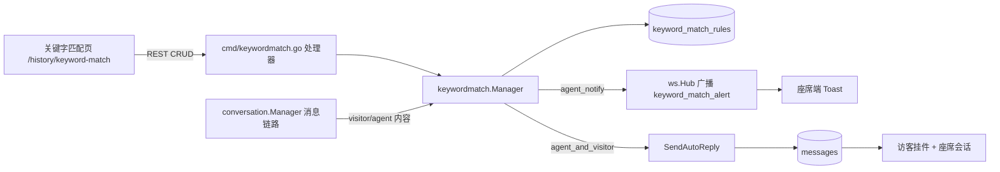

## 产品概述

在管理后台「在线客服」菜单下新增子菜单「关键字匹配」（位置紧跟「搜索」），提供一套**全局生效**的关键字匹配规则管理页面；同时在消息链路中加入匹配引擎，当访客或座席消息命中规则时，按规则配置的「执行」动作自动提示/回复。

## 核心功能

1. **菜单与页面入口**：「在线客服」下新增「关键字匹配」子菜单，紧邻「搜索」，点击进入规则管理页。
2. **规则列表页**：页面标题「关键字匹配」，右上角「添加关键字匹配规则」按钮；列表展示每条规则的规则名称、来源、匹配方式、匹配规则、区分大小写、搜索第一项、执行动作、回复内容；每条规则右侧提供删除按钮，点击规则行可打开弹窗编辑保存；空列表显示空状态提示。
3. **新建/编辑规则弹窗**：字段依次为规则名称（文本）、来源（访客消息/座席消息）、匹配方式（关键字/正则）、匹配规则（文本，正则时给出示例与校验）、区分大小写（勾选）、搜索第一项（勾选，命中第一条即停止）、执行（在座席端提示消息 / 在座席和访客端提示消息）、回复内容（多行文本，说明 `##` 会被替换为实际匹配到的关键字）；底部取消/保存。
4. **自动回复执行**：

- 「在座席端提示消息」：仅在座席端弹出系统提醒条（含规则名称与替换后的提示内容），**不写入会话**。
- 「在座席和访客端提示消息」：以系统身份向该会话发送一条自动回复消息，座席端与访客端（在线客服挂件）均可看到。

5. **匹配语义**：关键字方式支持多关键字（逗号/换行分隔）包含匹配；正则方式按正则匹配；区分大小写可选；`search_first` 为真时命中第一条规则即停止；同一条消息按来源（访客/座席）过滤规则。
6. **边界与防扰**：规则可停用；禁用/删除实时生效；快速回复（机器人）已产生回复时不再重复触发；系统自动回复消息不参与座席规则匹配，避免循环。

## 技术栈

- 前端：现有 Vue 3 + Vite + Tailwind CSS + `shared-ui` 组件库（shadcn 风格：Dialog / Select / Checkbox / Textarea / Button / Spinner / Table），状态用 `ref` 组合式写法，提示用 `useEmitter` + `EMITTER_EVENTS.SHOW_TOAST`。
- 后端：现有 Go + fasthttp/fastglue + sqlx + PostgreSQL，模块采用 `internal/<module>/{models,queries.sql,<module>.go}` 分层 + `dbutil.ScanSQLFile` 预编译查询；迁移为 `internal/migrations/vX_Y_Z.go` + `cmd/upgrade.go` 登记。
- 通讯：WebSocket 事件（`internal/ws`），座席端客户端维护在 `ws.Hub`，访客端由 livechat inbox 单独广播。

## 实现方案

**整体策略**：新建 `internal/keywordmatch` 模块（完全对齐 `internal/quickreply` 的组织方式：Manager + `queries` 预编译 + 后置注入 `SetConversationService` 避免循环依赖），在其内部完成「规则 CRUD」与「匹配 + 执行」两件事；HTTP 层新增 `cmd/keywordmatch.go` 并注册到 `cmd/handlers.go`；消息链路在 `ProcessIncomingLiveChatMessage`（访客在线消息）、`ProcessIncomingMessage`（邮件等入站）与 `QueueReply`（座席回复）三处挂钩。

**关键决策与取舍**

1. **全局规则表**（不按收件箱）：表 `keyword_match_rules` 无 `inbox_id`，一次查询即可加载全部启用规则，匹配在内存中完成；符合「全局生效」的确认结果，也避免多收件箱重复配置。
2. **座席端提示不落库**：选择新增 WS 事件 `keyword_match_alert` 推送给授权座席（复用 `AuthorizedConnectedAgentIDs`；结果为空时退回广播全部在线座席），前端弹 toast。这样满足「不写入会话」，也不会污染会话记录与未读计数。
3. **双端提示复用 `SendAutoReply`**：与 quickreply 同一条链路（系统用户身份、`silent=false`），座席端走既有 `new_message` 广播，访客端由 livechat inbox 广播，无需新增投递逻辑。
4. **规避重复/循环**：在 livechat 消息处理中，先执行 quickreply，仅当其未产出 bot 消息时才跑关键字匹配；座席来源规则跳过系统用户/机器人产生的消息（`SenderType`/meta 判定）。

**性能与可靠性**

- 规则量级为数十至数百条，采用「进程内短缓存（30s TTL，按 `updated_at` 最大值或写入时失效）」或每次匹配前一次 `SELECT`（当前 quickreply 亦为直接查库，量小无瓶颈）；优先采用「按会话启动时加载一次 + CRUD 后失效」的最小实现，避免每条消息一次查询。
- 正则在保存时 `regexp.Compile` 校验，匹配时复用编译结果缓存（`sync.Map`，key 为 pattern+case_sensitive）；非法正则在保存接口即拒绝，避免运行时报错。
- 匹配复杂度 O(规则数 × 内容长度)；`search_first` 命中即停，降低最坏情况开销。
- 执行失败只记日志（`m.lo.Error`），不影响主消息流程返回，保证消息入库不被自动回复阻塞。

## 实现要点（执行细节）

- 复用现有模式：`//go:embed queries.sql` + `dbutil.ScanSQLFile("queries.sql", &q, opts.DB, efs)`；错误统一 `envelope.NewError(envelope.InputError/GeneralError, m.i18n.T(...), nil)`。
- 权限：新增 `keyword_match:manage`（`internal/authz/models/models.go` 常量 + `validPermissions`），迁移中为 `Admin` 角色 `array_append`（幂等、带 `NOT (... = ANY(permissions))` 判断），并同步 `schema.sql` 的 Admin 权限数组与前端 `constants/permissions.js`。
- 迁移幂等：`CREATE TABLE IF NOT EXISTS`，登记 `{"v2.19.0", migrations.V2_19_0}` 到 `cmd/upgrade.go`。
- i18n：新增校验/提示文案与前端菜单、字段文案，写入 `i18n/zh-CN.json` 与 `i18n/en-US.json`（扁平 key）。
- 影响面控制：不改动 quickreply 现有行为；新字段/新表为新增；WS 新事件类型对旧客户端为未知类型（前端已有 `console.warn` 兜底）。

## 架构设计



## 目录结构

```
internal/keywordmatch/
├── models/models.go          # [NEW] KeywordMatchRule 结构体、来源/匹配方式/动作常量（visitor|agent、keyword|regex、agent_notify|agent_and_visitor）、请求/校验模型
├── queries.sql               # [NEW] 命名查询：get-all / get / insert / update / delete（dbutil.ScanSQLFile 扫描）
├── keywordmatch.go           # [NEW] Manager：New/SetConversationService、CRUD（GetAll/Get/Create/Update/Delete）、规则缓存与失效
├── match.go                  # [NEW] 匹配引擎：关键字包含匹配/正则匹配、区分大小写、search_first 短路、## 占位符替换为命中文本
└── execute.go                # [NEW] 动作执行：agent_notify（推送 WS 告警）与 agent_and_visitor（SendAutoReply）
internal/migrations/v2.19.0.go  # [NEW] 幂等建表 + 为 Admin 角色追加 keyword_match:manage 权限
internal/authz/models/models.go # [MODIFY] 新增 PermKeywordMatchManage 常量并注册到 validPermissions
internal/ws/models/models.go    # [MODIFY] 新增 MessageTypeKeywordMatchAlert = "keyword_match_alert"
internal/conversation/
├── conversation.go            # [MODIFY] Opts 增加 KeywordMatch 字段，Manager 增加 keywordMatch 字段
├── message.go                 # [MODIFY] 在 ProcessIncomingLiveChatMessage / ProcessIncomingMessage / QueueReply 中调用匹配引擎
└── ws.go                      # [MODIFY] 新增 BroadcastKeywordAlertToAgents（复用 AuthorizedConnectedAgentIDs + broadcastToUsers）
cmd/
├── keywordmatch.go            # [NEW] 五个 HTTP 处理器（列表/详情/创建/更新/删除），含字段校验与长度限制
├── handlers.go                # [MODIFY] 注册 /api/v1/keyword-match-rules 路由（perm keyword_match:manage）
├── init.go                    # [MODIFY] initKeywordMatch、initConversations 增加入参并注入会话服务
├── main.go                    # [MODIFY] App 结构体增加 keywordMatch 字段与初始化接线
└── upgrade.go                 # [MODIFY] migList 登记 v2.19.0
schema.sql                     # [MODIFY] 新增 keyword_match_rules 表 + Admin 角色权限数组追加
i18n/zh-CN.json、i18n/en-US.json  # [MODIFY] 后端校验文案与前端页面文案
frontend/apps/main/src/
├── constants/navigation.js    # [MODIFY] historyNavItems「在线客服」children 在 search 后插入 keyword-match
├── components/sidebar/Sidebar.vue # [MODIFY] navIconMap 增加 Regex 图标（lucide-vue-next）
├── router/index.js            # [MODIFY] /history 组新增 keyword-match 路由
├── api/index.js               # [MODIFY] 关键字规则 CRUD 接口封装并导出
├── constants/websocket.js     # [MODIFY] WS_EVENT 新增 KEYWORD_MATCH_ALERT
├── websocket.js               # [MODIFY] handleMessage 增加该事件分支，弹系统提示
├── constants/permissions.js   # [MODIFY] 新增 KEYWORD_MATCH_MANAGE
├── views/history/HistoryKeywordMatchView.vue # [NEW] 规则列表页：标题、右上添加按钮、列表、删除确认、编辑入口
└── features/history/keywordmatch/KeywordRuleDialog.vue # [NEW] 新建/编辑规则弹窗（全部字段 + 校验 + 保存）
```

## 关键代码结构

```
// internal/keywordmatch/models/models.go
type KeywordMatchRule struct {
    ID            int       `db:"id" json:"id"`
    Name          string    `db:"name" json:"name"`
    Source        string    `db:"source" json:"source"`               // visitor | agent
    MatchType     string    `db:"match_type" json:"match_type"`       // keyword | regex
    Pattern       string    `db:"pattern" json:"pattern"`
    CaseSensitive bool      `db:"case_sensitive" json:"case_sensitive"`
    SearchFirst   bool      `db:"search_first" json:"search_first"`
    Action        string    `db:"action" json:"action"`               // agent_notify | agent_and_visitor
    ReplyContent  string    `db:"reply_content" json:"reply_content"` // 支持 ## 占位符
    Enabled       bool      `db:"enabled" json:"enabled"`
    SortOrder     int       `db:"sort_order" json:"sort_order"`
    CreatedAt     time.Time `db:"created_at" json:"created_at"`
    UpdatedAt     time.Time `db:"updated_at" json:"updated_at"`
}
```

```
// internal/keywordmatch/keywordmatch.go
type ConversationService interface {
    SendAutoReply(inboxID, contactID int, conversationUUID, content string, metaMap map[string]any, silent bool) (cmodels.Message, error)
    GetConversation(id int, uuid, subjectRef string) (cmodels.Conversation, error)
    AuthorizedConnectedAgentIDs(assignedUserID, assignedTeamID null.Int) []int
    BroadcastToAgents(userIDs []int, eventType string, data map[string]any) // conversation.Manager 侧实现，空 userIDs 表示广播全部在线座席
}

// 匹配入口：source 为 "visitor" 或 "agent"，返回命中的规则与替换 ## 后的内容，交由 execute 执行
func (m *Manager) MatchAndExecute(conversation cmodels.Conversation, content, source string) error
```

## 设计风格

沿用现有 libredesk 后台（History 系列页面）的简洁企业管理台风格：白底卡片、细边框、克制阴影、圆角 8px、主色仅用于主按钮与选中态，整体与「会话记录 / 搜索」页面视觉一致。

## 页面一：关键字匹配（列表页 /history/keyword-match）

- **顶部标题栏**：左侧 H1「关键字匹配」（24px/600），右上角主色实心按钮「+ 添加关键字匹配规则」，与 HistorySearchView 的 `p-6` 内边距与标题层级保持一致。
- **规则列表卡片**：白底卡片 + 表头（规则名称 / 来源 / 匹配方式 / 匹配规则 / 区分大小写 / 搜索第一项 / 执行 / 回复内容 / 操作）；来源、匹配方式、执行以中性色胶囊标签呈现（访客消息蓝、座席消息紫；关键字灰蓝、正则靛蓝）；布尔列用对勾/短横图标；回复内容超长省略并显示 title 悬浮全文。
- **行交互**：整行 hover 高亮（`bg-accent/40`）表示可点击编辑；操作列删除图标 hover 变红并弹出 AlertDialog 二次确认；加载中显示 Spinner，无数据显示居中空状态插画文案。
- **删除确认弹窗**：标题「删除规则」，描述含规则名称，取消/确认删除（destructive 按钮）。

## 页面二：新建/编辑规则弹窗

- **弹窗容器**：居中 Dialog，宽度约 560px，标题「添加关键字匹配规则 / 编辑关键字匹配规则」，右上角关闭；内容区可滚动，底部右对齐「取消 / 保存」。
- **表单区（纵向栅格，标签左对齐，控件撑满）**：规则名称（Input，必填）；来源（Select：访客消息 / 座席消息，默认访客消息）；匹配方式（Select：关键字 / 正则，默认关键字）；匹配规则（Input/Textarea，正则模式下placeholder 给出示例并实时校验，错误红字提示）；区分大小写、搜索第一项（Checkbox 一行两项或分行，附简短说明）；执行（Select：在座席端提示消息 / 在座席和访客端提示消息）；回复内容（Textarea，下方灰色说明「## 会替换为匹配到的关键字」）。
- **交互反馈**：保存按钮 loading 态；字段校验内联红字；保存成功 toast 并关闭弹窗、列表局部刷新。

## 页面三：座席端系统提示（全局）

- 命中「在座席端提示消息」时，右下角（或编辑器上方）弹出系统提示条：主色左边框、规则名称加粗标题 + 提示内容正文，5 秒自动消失，不写入会话、不产生未读。

## 响应式与可达性

- 列表在窄屏横向滚动，弹窗改为全宽；所有交互元素可见焦点环；标签与图标按钮带 `aria-label`；删除按钮有 `sr-only` 文本。

## Agent Extensions

### SubAgent

- **code-explorer**
- Purpose：在实现阶段定位并核对全部改动点（conversation.Manager Opts 与消息挂钩位置、`SendAutoReply`/`AuthorizedConnectedAgentIDs` 签名、Sidebar `navIconMap`、api/index.js 导出区、i18n 插入位置）
- Expected outcome：产出准确的调用点清单与待改文件行号，避免遗漏接线（特别是座席消息来源的 `QueueReply` 挂钩与 `Admin` 角色权限追加）