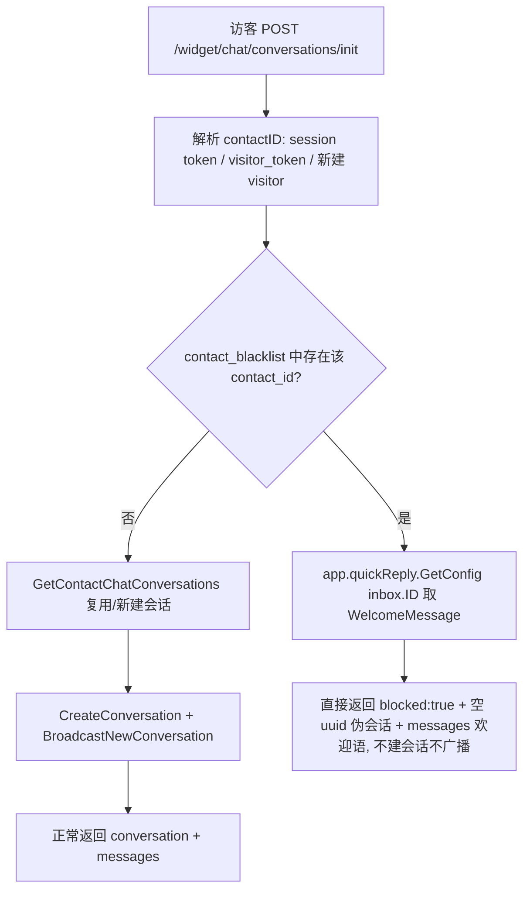

## 用户需求

为客服系统新增「在线黑名单」能力，包含三部分：

1. **会话侧客户信息面板的黑名单操作**

- 点击会话记录右侧弹出的客户信息，在其下方增加「加入在线黑名单」/「移除在线黑名单」按钮（已在黑名单内显示"移除"，否则显示"加入"）。
- 点击「加入在线黑名单」：弹出确认弹窗，含原因输入框 + 取消/确认按钮。
- 点击「移除在线黑名单」：弹出纯确认弹窗，仅取消/移除按钮。

2. **服务历史新增「客户」菜单**

- 在「服务历史」下与「在线客服」并列新增「客户」菜单，下含「客户信息」「操作日志」两个子菜单。
- 客户信息页：Tab「全部」（所有客户）/「在线黑名单」（当前在黑名单中的客户，带数量徽标）；列表列为 客户昵称 / 操作人 / 操作时间 / 操作原因 / 操作（最右为"移除在线黑名单"，点击弹出纯确认弹窗）；右上角「筛选排序」按钮。
- 操作日志页：Tab「全部」；列表列为 操作时间 / 操作内容 / 操作人 / 昵称 / 操作原因；右上角「筛选排序」按钮。

3. **黑名单拦截（完全不落库）**

- 被拉黑客户创建新会话时：系统只自动回复欢迎语，其他任何回复都不触发；不创建会话、不广播给客服后台、服务历史也不生成该会话记录。

## 产品概述

面向坐席的客户管控功能：坐席可在会话中或客户列表页一键拉黑/解除拉黑客户，并填写原因；所有拉黑/解除动作留痕可查；被拉黑访客的会话在后台完全不可见，仅收到欢迎语。

## 核心特性

- 会话右侧客户信息下方的黑名单按钮（状态自适应）+ 加入（填原因）/ 移除（纯确认）弹窗
- 服务历史「客户」菜单下的客户信息列表（全部 / 在线黑名单 Tab + 数量徽标 + 筛选排序 + 行内移除）
- 服务历史「客户」菜单下的操作日志列表（仅黑名单相关操作：操作时间 / 操作内容 / 操作人 / 昵称 / 操作原因）
- 后端拦截：黑名单客户新会话不落库、不广播、无历史记录，仅返回欢迎语
- 权限：不设限制，任何登录坐席均可操作

## 技术栈

- 后端：Go + fasthttp/fastglue + Postgres/sqlx，沿用现有分层（`cmd/` 路由与 handler → `internal/<module>/` Manager + `queries.sql` + `models/`）
- 前端：Vue 3 + Vite + `@shared-ui/components/ui/*`（shadcn 风格 Radix 组件）+ lucide-vue-next + vue-i18n + Pinia
- 数据库迁移：`internal/migrations/vX.Y.Z.go`，注册到 `cmd/upgrade.go` 的 `migList`
- SQL 组织：`//go:embed queries.sql` + `dbutil.ScanSQLFile`（**不使用 sqlc 代码生成**），查询名用 `-- name: xxx` 注释

## 实现方案

### 1. 数据模型（新增两张表，不改 `users` 表语义）

- `contact_blacklist`（当前黑名单状态，行存在即黑名单）：`id, contact_id UNIQUE, reason, created_by, created_at, updated_at`
- `contact_blacklist_logs`（追加式历史）：`id, contact_id, action('add'|'remove'), reason, actor_id, created_at`

**为何不复用 `users.enabled=false`**：现有 `PUT /api/v1/contacts/{id}/block` 只切换 `enabled`，无原因/操作人/时间字段，且语义是"屏蔽联系人"（影响邮件渠道）。新增独立表可与既有机制完全隔离，避免改动邮件渠道行为，也天然支撑"操作日志"页。两个表分治"当前状态"与"历史流水"，查询无歧义。

### 2. 拦截流程（完全不落库）



- 拦截点插在 `cmd/chat.go:269`（contactID 确定之后、`GetContactChatConversations` 之前），保证既不新建也不复用/重开会话。
- 欢迎语取 `app.quickReply.GetConfig(inbox.ID).WelcomeMessage`（`app.quickReply` 已在 `cmd/init.go:318` 挂到 App），沿用 `cfg.Enabled && WelcomeMessage != ""` 的既有判断；不调用依赖会话 UUID 的 `SendAutoReply`。
- `handleChatSendMessage`（`cmd/chat.go:684`）同样加黑名单护栏：若命中则直接返回欢迎语、不 `InsertMessage`、不广播，防止绕过。
- 边界说明：访客 `users` 行仍会创建（`visitor_token` 是识别黑名单客户的唯一依据），但**不创建任何会话记录**，故后台列表与服务历史均无痕。

### 3. 接口（仅 `auth()` 包装，不加 `perm`，用户确认不设权限）

| 方法 | 路径 | 说明 |
| --- | --- | --- |
| GET | `/api/v1/contacts/{id}/blacklist` | 返回 `{blocked, reason, created_by, created_at}`，供侧栏按钮取状态 |
| POST | `/api/v1/contacts/{id}/blacklist` | 请求体 `{reason}`，加入黑名单（已存在则更新原因与操作人） |
| DELETE | `/api/v1/contacts/{id}/blacklist` | 移除黑名单（不存在也返回成功，幂等） |
| GET | `/api/v1/blacklist/customers` | 参数 `filter=all\ | blocked`、`search`、`order`、`orderBy`、`page`、`page_size`；返回 `{results, total, blocked_count}` |
| GET | `/api/v1/blacklist/logs` | 参数 `search`、`action`、`order`、`orderBy`、`page`、`page_size`；返回 `{results, total}` |


- `blacklist.Manager` 同时写入 `contact_blacklist` 与 `contact_blacklist_logs`（同一事务）。
- 列表查询用 `users` LEFT JOIN / JOIN 取昵称与操作人姓名（`first_name || last_name`，为空回退 `email`），`COUNT(*) OVER()` 取 total（与 `get-all-activities` 一致）。

### 4. 前端结构

- 新建 `features/blacklist/`：`useBlacklist.js`（状态查询/加入/移除/toast/竞态保护）+ `BlacklistAction.vue`（状态化按钮 + 两个弹窗，props 为 contact，供会话侧栏与客户信息表格复用，DRY）。
- 会话侧栏：在 `ConversationSideBar.vue` 中 `<ConversationSideBarContact class="p-4" />` 正下方插入 `<BlacklistAction :contact="conversationStore.current.contact" />`（即"客户信息下方"）。
- 服务历史新增两个视图 + 表格/筛选子组件，沿用 `HistoryConversationsView.vue` 的布局范式（标题行 + 右上角筛选排序按钮 + Tab + DataTable + 右侧滑出筛选面板）。
- 菜单：`navigation.js` 的 `historyNavItems` 增加第二项「客户」（`children` 两个子项）；路由在 `router/index.js` 的 `/history` children 增加 `customers`、`customer-logs`。

## 实现要点（防回归）

- **Widget 端必须适配**：`frontend/apps/widget` 的 `App.vue:78`、`ChatView.vue:160`、`ConversationsView.vue:73`、`MessageInput.vue:94` 都会解构 `conversation` 并赋值（`conversation.business_hours_id = ...`），返回 `conversation: null` 会直接抛错。因此后端返回**伪会话对象** `{uuid: "", ...}` + `messages:[欢迎语]` + `blocked:true`；前端在四处 init 调用点判 `blocked` 时只 `replaceMessages`、不 `addConversationToList`。`MessageInput.vue:180` 已有 `if (!chatStore.currentConversation.uuid) → initChatConversation` 分支，空 uuid 会自然走 init，再次拿到欢迎语，符合"其他任何都不会回复"。
- **不改既有屏蔽逻辑**：`PUT /api/v1/contacts/{id}/block` 与 `users.enabled` 保持原样，黑名单功能对其零侵入。
- **索引与性能**：`contact_blacklist(contact_id)` 唯一索引、`contact_blacklist_logs(contact_id)` 与 `(created_at DESC)` 索引；侧栏状态查询走主键命中，列表查询走分页 + 索引，避免全表扫描。
- **日志**：沿用 `app.lo.Info("...", "contact_id", ..., "actor_id", ...)` 风格（同 `handleBlockContact:278`），不落库敏感内容；错误统一走 `sendErrorEnvelope`。
- **i18n**：新增扁平点号 key，至少同步 `i18n/en-US.json` 与 `i18n/zh-CN.json`；中文按需求措辞（"加入在线黑名单"、"移除在线黑名单"、"客户信息"、"操作日志"、"操作原因"）。
- **迁移**：`internal/migrations/v2.15.0.go`（`CREATE TABLE IF NOT EXISTS` + `CREATE INDEX IF NOT EXISTS`），必须加进 `cmd/upgrade.go` 的 `migList`，并在 `schema.sql` 同步基线表定义。

## 架构设计

```
cmd/                          HTTP 层（路由注册 + handler + App 接线）
 ├─ blacklist.go   [NEW]      黑名单 handler（auth 包装，无 perm）
 ├─ handlers.go    [MODIFY]   注册 5 条黑名单路由
 ├─ chat.go        [MODIFY]   init/send 拦截黑名单客户
 ├─ init.go/main.go[MODIFY]   初始化并挂载 blacklist.Manager
internal/blacklist/           [NEW] 领域层（Manager + queries.sql + models）
internal/migrations/v2.15.0.go[NEW] 建表迁移
frontend/apps/main/src/
 ├─ features/blacklist/       [NEW] useBlacklist.js + BlacklistAction.vue（侧栏与列表共用）
 ├─ features/conversation/sidebar/ConversationSideBar.vue [MODIFY] 客户信息下方插入操作按钮
 ├─ features/history/         [NEW] 客户表格/日志表格/筛选面板
 └─ views/history/            [NEW] HistoryCustomersView.vue、HistoryBlacklistLogsView.vue
frontend/apps/widget/src/     [MODIFY] 适配 blocked 响应
```

## 目录结构

```
e:/libredesk/
├── internal/blacklist/
│   ├── models/models.go      # [NEW] Blacklist（contact_id/reason/created_by/created_at）、BlacklistLog（action/reason/actor_id/created_at）、列表行视图结构（含昵称、操作人姓名）
│   ├── queries.sql           # [NEW] get-blacklist / insert-blacklist / delete-blacklist / get-blacklist-customers / get-blacklist-logs / insert-blacklist-log，风格同 internal/activity_log/queries.sql
│   └── blacklist.go          # [NEW] Manager：IsBlocked、Add（事务：upsert 状态 + 追加日志）、Remove（事务：删状态 + 追加日志）、GetCustomers、GetLogs；Opts{DB,Lo}
├── internal/migrations/
│   └── v2.15.0.go            # [NEW] 建 contact_blacklist、contact_blacklist_logs 及索引；注册到 cmd/upgrade.go 的 migList
├── schema.sql                # [MODIFY] 同步两张新表的基线定义
├── cmd/
│   ├── blacklist.go          # [NEW] handleGetContactBlacklist / handleAddContactBlacklist / handleRemoveContactBlacklist / handleGetBlacklistCustomers / handleGetBlacklistLogs（auser.ID 作为 actor）
│   ├── handlers.go           # [MODIFY] 5 条路由，仅 auth() 包装
│   ├── chat.go               # [MODIFY] handleChatInit（contactID 解析后拦截，返回伪会话+欢迎语）、handleChatSendMessage 护栏
│   ├── init.go               # [MODIFY] initBlacklist(db, lo) 并在 App 构造处传参
│   └── main.go               # [MODIFY] App struct 增加 blacklist *blacklist.Manager
├── frontend/apps/main/src/
│   ├── api/index.js          # [MODIFY] 新增 getContactBlacklist/addContactBlacklist/removeContactBlacklist/getBlacklistCustomers/getBlacklistLogs 并加入 default 导出
│   ├── features/blacklist/
│   │   ├── useBlacklist.js   # [NEW] 状态、提交、竞态保护、统一 toast（EMITTER_EVENTS.SHOW_TOAST）
│   │   └── BlacklistAction.vue # [NEW] 状态化按钮 + 加入弹窗（原因 Textarea，必填）+ 移除弹窗（仅取消/移除）
│   ├── features/conversation/sidebar/ConversationSideBar.vue # [MODIFY] 在 ConversationSideBarContact 下方插入 BlacklistAction
│   ├── features/history/
│   │   ├── CustomerBlacklistTable.vue   # [NEW] 客户信息表格（客户昵称/操作人/操作时间/操作原因/操作）
│   │   ├── CustomerBlacklistFilters.vue # [NEW] 客户信息筛选排序面板
│   │   ├── BlacklistLogTable.vue        # [NEW] 操作日志表格（操作时间/操作内容/操作人/昵称/操作原因）
│   │   └── BlacklistLogFilters.vue      # [NEW] 操作日志筛选排序面板
│   ├── views/history/
│   │   ├── HistoryCustomersView.vue     # [NEW] 客户信息页（全部/在线黑名单 Tab + 数量徽标 + 筛选排序 + 行内移除）
│   │   └── HistoryBlacklistLogsView.vue # [NEW] 操作日志页（Tab 全部 + 筛选排序）
│   ├── router/index.js       # [MODIFY] /history children 增加 customers、customer-logs
│   └── constants/navigation.js # [MODIFY] historyNavItems 增加「客户」及两个子菜单
├── frontend/apps/widget/src/
│   ├── App.vue               # [MODIFY] init 响应判 blocked，跳过入列、只替换消息
│   ├── views/ChatView.vue    # [MODIFY] 同上
│   ├── views/ConversationsView.vue # [MODIFY] 同上
│   └── components/MessageInput.vue # [MODIFY] 空 uuid 走 init，仅回欢迎语
└── i18n/
    ├── en-US.json            # [MODIFY] 新增 blacklist.*、history.customer* 等 key
    └── zh-CN.json            # [MODIFY] 中文文案
```

## 关键数据结构

```
// internal/blacklist/models/models.go
type Blacklist struct {
    ID        int       `db:"id" json:"id"`
    ContactID int       `db:"contact_id" json:"contact_id"`
    Reason    string    `db:"reason" json:"reason"`
    CreatedBy int       `db:"created_by" json:"created_by"`
    CreatedAt time.Time `db:"created_at" json:"created_at"`
    UpdatedAt time.Time `db:"updated_at" json:"updated_at"`
}

type BlacklistLog struct {
    ID        int       `db:"id" json:"id"`
    ContactID int       `db:"contact_id" json:"contact_id"`
    Action    string    `db:"action" json:"action"` // "add" | "remove"
    Reason    string    `db:"reason" json:"reason"`
    ActorID   int       `db:"actor_id" json:"actor_id"`
    CreatedAt time.Time `db:"created_at" json:"created_at"`
}
```

Manager 对外方法（签名）：`IsBlocked(contactID int) (bool, error)`、`Add(contactID, actorID int, reason string) error`、`Remove(contactID, actorID int) error`、`GetCustomers(filter, search, order, orderBy string, page, pageSize int) ([]CustomerRow, int, int, error)`（返回行、总数、黑名单总数）、`GetLogs(search, action, order, orderBy string, page, pageSize int) ([]LogRow, int, error)`

## 设计风格

沿用 LibreDesk 管理后台既有的中性偏冷、克制的现代 SaaS 风格（slate 中性底 + 蓝色主色），保证与「在线客服 / 会话记录」等既有页面视觉一致。破坏性操作（加入/移除黑名单）使用红色语义：侧栏按钮为红色描边幽灵态，弹窗主按钮为实心红；表格行内「移除在线黑名单」用图标 + 文字的幽灵按钮，hover 转红。

## 页面一：会话右侧客户信息面板（新增区块）

- 位置：客户信息卡（头像/昵称/邮箱/电话等）正下方、Accordion 之上，独占一行。
- 表现：整宽按钮，左侧 `ShieldOff`/`ShieldCheck` 图标，文案按状态在「加入在线黑名单」与「移除在线黑名单」间切换；加载中按钮禁用并显示 spinner。
- 加入弹窗：标题「加入在线黑名单」+ 说明文案 + 原因输入（Textarea，必填，空值禁用确认按钮）+ 底部「取消 / 确认」。
- 移除弹窗：标题「移除在线黑名单」+ 说明文案 + 底部「取消 / 移除」，无输入项。
- 成功后 toast 提示并即时切换按钮状态。

## 页面二：客户信息（服务历史 > 客户 > 客户信息）

- 顶部：标题「客户信息」+ 总数说明；右上角「筛选排序」按钮（带 Filter 图标，激活态高亮）。
- Tab 栏：「全部」「在线黑名单」（后者带数字徽标，实时显示当前黑名单数量）。
- 表格列：客户昵称 / 操作人 / 操作时间 / 操作原因 / 操作（最右为「移除在线黑名单」图标按钮，点击弹出纯确认弹窗；未拉黑客户该列为空）。
- 右侧滑出筛选面板（复用现有 splitter 拖拽交互）：按昵称/操作人搜索、时间范围、排序方式。
- 底部：加载更多 / 分页；空态居中提示。

## 页面三：操作日志（服务历史 > 客户 > 操作日志）

- 顶部：标题「操作日志」+ 右上角「筛选排序」按钮；Tab「全部」。
- 表格列：操作时间 / 操作内容（如「加入在线黑名单」「移除在线黑名单」）/ 操作人 / 昵称 / 操作原因。
- 右侧筛选面板：按操作类型、操作人、昵称、时间范围过滤与排序。

## 交互与响应式

- 表格行 hover 高亮；按钮 hover/active 有 150ms 过渡；弹窗带淡入 + 轻微缩放动效。
- 桌面端优先（与既有后台一致），窄屏时表格横向滚动，筛选面板改为浮层覆盖。

## Agent Extensions

### SubAgent

- **code-explorer**
- Purpose: 在实现黑名单拦截前，穷举 `frontend/apps/widget/src` 中所有调用 `initChatConversation` 的位置以及所有依赖 `conversation.uuid` 的分支（已知 App.vue、ChatView.vue、ConversationsView.vue、MessageInput.vue），确认无遗漏并核对 `cmd/chat.go` 中 contactID 解析后所有出口分支
- Expected outcome: 输出完整调用点清单与需加 `blocked` 判断的确切行号，避免 widget 端因空会话崩溃或漏改导致黑名单客户仍能进入后台