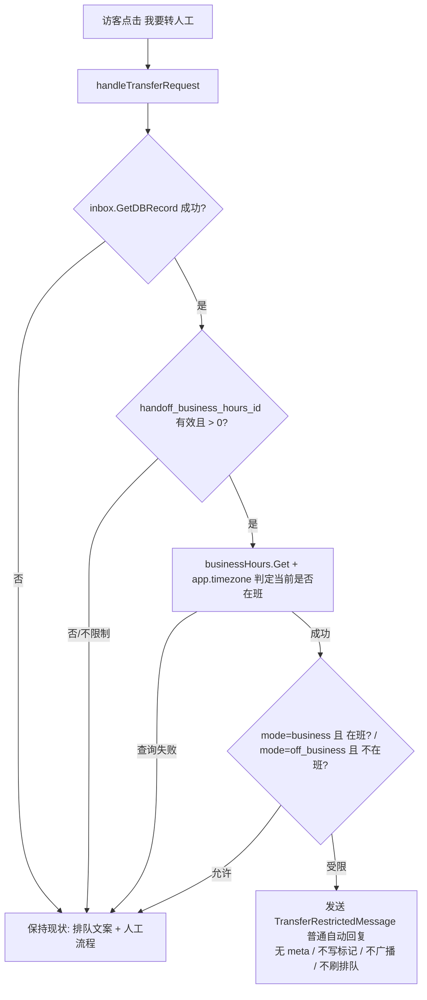

## 产品概述

在管理端「快捷回复 - 自动回复文案」中新增「限制转人工提示语」配置项，并让 widget 端点击「我要转人工」时依据收件箱「转人工设置」的时间窗做分流判定。

## 核心功能

1. **新增配置项**：在自动回复文案卡片中，「排队文案」之后新增「限制转人工提示语」多行文本字段（`transfer_restricted_message`），带说明文案、持久化到收件箱快捷回复配置，符合现有 6 个文案字段同样的输入框／校验／保存风格。
2. **时间窗分流**：收件箱「转人工设置」中选了时间段后（非“不限制”），widget 端点击「我要转人工」时：

- 勾选「只允许上班时间」且当前处于上班时间 → 回复「排队文案」并进入人工排队流程；当前处于下班时间 → 回复「限制转人工提示语」。
- 勾选「只允许下班时间」且当前处于下班时间 → 回复「排队文案」并进入人工排队流程；当前处于上班时间 → 回复「限制转人工提示语」。
- 收件箱未选择时间段（“不限制”）→ 保持原有行为，直接回复「排队文案」并进入人工排队流程。

3. **达到的视觉效果／行为差异**：走人工流程时会话出现排队人数气泡与常驻排队 footer 并广播到客服工作台；被限制时仅出现一条普通机器人气泡，不显示排队信息、不进入客服排队队列，访客稍后在允许时段再次点击仍可正常转人工。
4. 手动输入转人工触发词与点击按钮行为一致（二者共用同一条触发分支）。

## 技术栈

- 后端：Go 1.x + sqlx + PostgreSQL（现有 `internal/quickreply`、`internal/inbox`、`internal/business_hours`、`internal/setting`、`cmd` 分层）
- 前端：Vue 3 SFC + vee-validate + zod + `@shared-ui` 组件库（现有 `QuickReplyConfig.vue` 表单）
- 迁移：现有自定义 semver Go 迁移框架（`cmd/upgrade.go` 的 `migList`）
- i18n：`i18n/zh-CN.json`、`i18n/en-US.json`

## 实现方案

**核心结论**：收件箱的 `handoff_business_hours_id` / `handoff_hours_mode` 目前只在 CRUD 时校验落库，**`handleTransferRequest`（`internal/quickreply/quickreply.go:780`）从未读取**，这是本次要补齐的唯一缺口。

**总体策略**：纯增量改造，不重构既有结构和调用签名之外的内容。

1. **配置落地（数据层）**：`inbox_quick_reply_configs` 增加 `transfer_restricted_message TEXT NULL`，遵循 `no_reply_timeout_reply`（v2.10.0）的做法——迁移用 `ADD COLUMN IF NOT EXISTS`，读取查询用 `COALESCE` 兜底，避免为存量行加 NOT NULL 列。
2. **营业时段判定（可复用能力）**：`internal/business_hours/business_hours.go` 目前只有 CRUD，**没有**「当前时刻是否在班」的判定。新增导出方法，内部复用 `sla/calculator.go` 同样的 JSON 兼容解析（多时段数组 + legacy 单对象、节假日日期区间），现有 `parseTime`/`nextDay` 未导出故无法跨包复用，需在本包内实现一份轻量解析。放在 `business_hours` 包而非 `quickreply` 包，便于后续 SLA／自动化规则复用（DRY、SoC）。
3. **依赖注入（避免循环依赖）**：沿用现有 `SetConversationService` 的后置注入模式，给 `quickreply.Manager` 增加三个窄接口：`InboxService.GetDBRecord`、`BusinessHoursService.Get`、`SettingsService.GetByPrefix`。仅依赖 `imodels` / `bhmodels` 两个 leaf models 包，**不会产生包循环**。在 `cmd/init.go` 中，`initQuickReply` 已无法拿到这些依赖，因此在调用点（`App` 装配处）补充 `SetXxxService` 调用，与现有 `SetConversationService(c)` 并列。
4. **分流判定（业务层）**：在 `handleTransferRequest` 最前面加一个前置判定，受限且不在允许时段时走「限制分支」并直接 return，保持主流程代码零改动。

**判定伪代码**：



## 实现要点（执行细节）

- **失败一律放行（fail-open）**：读取收件箱记录、营业时段、时区任一步出错（如 business hours 已被删除导致 FK SET NULL 后仍残留脏 ID、`time.LoadLocation` 失败），**不应阻塞访客转人工**，应 `m.lo.Error` 记录后按「允许」走原有排队流程。这保证新逻辑不会因配置异常导致访客无法联系人工（可靠性优先）。
- **时区取值**：`business_hours` 记录本身不含时区，取 `app.timezone`（从 `setting.Manager.GetByPrefix("app")` 解析），与 `conversation.go:2448-2470` 的回退策略一致；解析失败回退 `UTC`。
- **限制分支的副作用控制**：使用 `m.conv.SendAutoReply(..., nil, true)`（meta 为 nil、silent=true），**不写入** `ConversationMetaBotHumanRequested` 与 `ConversationMetaQueueInfo`，**不调用** `BroadcastNewConversationByUUID` 与 `RefreshWaitingQueueInfo`。这既避免污染客服工作台的排队列表，也保证访客稍后在允许时段再次点击可正常入队。
- **空文案兜底**：`TransferRestrictedMessage` 为空时用新增 i18n key `quickReply.transferRestricted` 的默认文案（与现有 `m.i18n.T("quickReply.selectQuestion")` 兜底惯例一致），绝不发送空消息。
- **性能**：仅访客消息命中触发词时触发，路径内含 1 次收件箱查询 + 1 次营业时段查询 + 1 次 settings 查询，均在 `O(1)`；营业时段 JSON 每次解析（数组极小），无需缓存，避免引入失效复杂度。
- **向后兼容**：`upsert-config` 用 `on conflict ... do update set` 追加新列，存量配置行写入前为 NULL，API 返回经 `COALESCE` 转为空串，前端 `loadConfig` 已有 `|| ''` 兜底，老数据零影响。
-  **BLAST RADIUS**：不触碰 `HandleIncomingMessage` 的其余分支、不修改排队角色級 звук widget 端代码、不动 `v2.17.0` 及更早迁移。

## 目录结构

```
e:/libredesk/
├── internal/migrations/
│   └── v2.18.0.go                                    # [NEW] 迁移 V2_18_0：inbox_quick_reply_configs 增加 transfer_restricted_message TEXT NULL（沿用 v2.10.0.go 的 ADD COLUMN IF NOT EXISTS 风格，注释说明用途）
├── cmd/
│   ├── upgrade.go                                    # [MODIFY] migList 末尾注册 {"v2.18.0", migrations.V2_18_0}
│   ├── quickreply.go                                 # [MODIFY] quickReplyConfigRequest 增加 transfer_restricted_message；handleUpdateQuickReplyConfig 增加 TrimSpace、长度校验（复用 maxQuickReplyFieldLength）、传入 UpsertConfig
│   └── init.go                                       # [MODIFY] 在 App 装配处（紧邻现有 SetConversationService）补充 SetInboxService / SetBusinessHoursService / SetSettingsService
├── internal/quickreply/
│   ├── models/models.go                              # [MODIFY] InboxQuickReplyConfig 增加 TransferRestrictedMessage（db/json: transfer_restricted_message）
│   ├── queries.sql                                   # [MODIFY] get-config 增加 COALESCE(transfer_restricted_message,'')；upsert-config 列与占位符扩展并同步 update set
│   └── quickreply.go                                 # [MODIFY] 1) 新增 InboxService/BusinessHoursService/SettingsService 接口与 Set*Service 方法 2) UpsertConfig 增加 transferRestrictedMessage 参数 3) 新增 handoffAllowedNow / sendRestrictedReply 辅助函数 4) handleTransferRequest 前置时间窗判定
├── internal/business_hours/
│   └── business_hours.go                             # [MODIFY] 新增导出 IsWithinBusinessHours(bh models.BusinessHours, tz string, now time.Time) (bool, error)：IsAlwaysOpen 短路、时区解析、多时段/legacy 双格式解析、节假日日期区间判定
├── schema.sql                                        # [MODIFY] inbox_quick_reply_configs 表定义（315-329 行）补 transfer_restricted_message TEXT NULL，供全新安装使用
├── frontend/apps/main/src/views/admin/quickreply/
│   └── QuickReplyConfig.vue                          # [MODIFY] 在「排队文案」后插入「限制转人工提示语」FormField（Textarea rows=3 + FormDescription）；zod schema 增加 transfer_restricted_message: z.string()；loadConfig / saveConfig payload 补齐该字段
└── i18n/
    ├── zh-CN.json                                    # [MODIFY] admin.quickReply.transferRestrictedMessage + .description；运行时兜底 quickReply.transferRestricted
    └── en-US.json                                    # [MODIFY] 同上英文版
```

## 关键接口（契约）

```
// internal/business_hours/business_hours.go
// 判断给定时刻是否落在营业时段内。IsAlwaysOpen 恒为 true；节假日当天为 false；
// 支持 {"Monday":[{"open":"09:00","close":"18:00"}]} 与 legacy {"Monday":{"open":..,"close":..}} 双格式。
// tz 无效时回退 UTC 而非报错。
func (m *Manager) IsWithinBusinessHours(bh models.BusinessHours, tz string, now time.Time) (bool, error)

// internal/quickreply/quickreply.go
// 与现有 SetConversationService 同风格的后置注入，用于打破包循环依赖。
func (m *Manager) SetInboxService(svc InboxService)
func (m *Manager) SetBusinessHoursService(svc BusinessHoursService)
func (m *Manager) SetSettingsService(svc SettingsService)

type InboxService interface {
    GetDBRecord(identifier any) (imodels.Inbox, error)
}
type BusinessHoursService interface {
    Get(id int) (bhmodels.BusinessHours, error)
}
type SettingsService interface {
    GetByPrefix(prefix string) (types.JSONText, error)
}
```