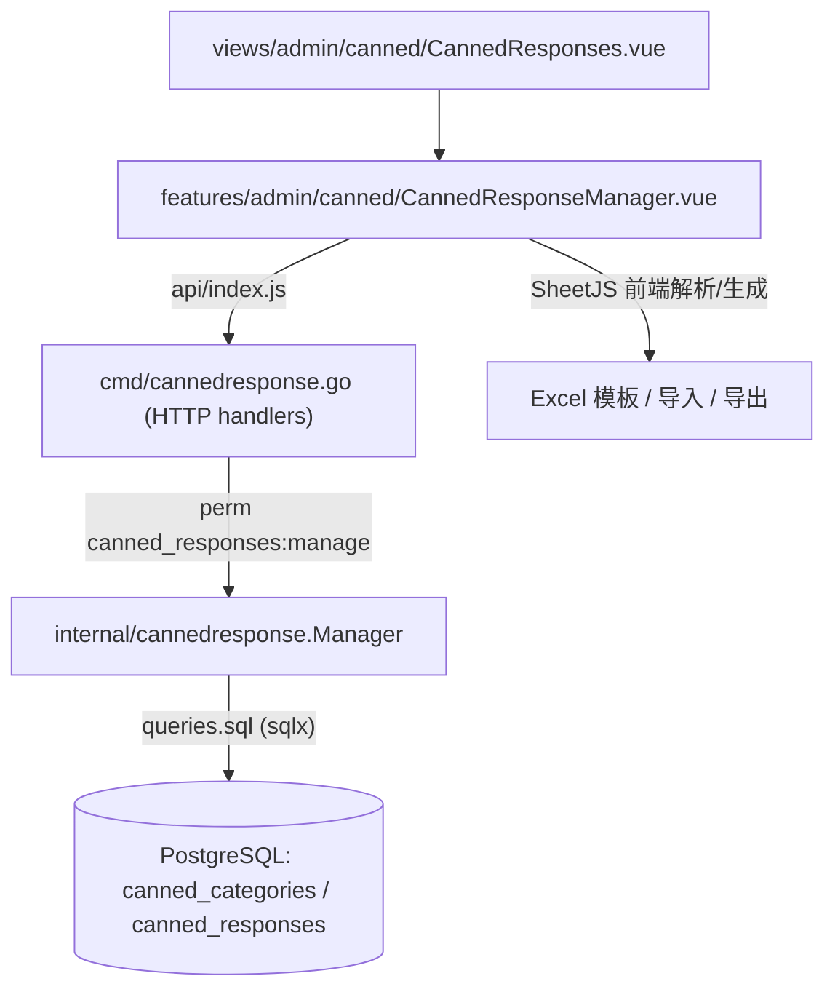

## 产品概述

在管理后台「渠道」分组下新增「公共常用语」菜单（位于「快捷回复」下方），提供**全局（跨收件箱）**常用语的分级管理与批量导入导出能力。该功能与既有「按收件箱配置的快捷回复」相互独立、互不影响。

## 核心功能

- 页面为左右两栏：左侧为可多级展开/折叠的「分类」树，右侧展示所选分类下的「常用语」列表。
- 分类支持多级（一级/二级/更深层）：新增子分类、重命名、删除（删除分类时级联删除其子分类与常用语）。
- 常用语条目支持新增、编辑（多行文本）、上移、下移、删除。
- 顶部工具条：左半部分为「添加常用语」快捷下拉（新建分类 / 新建常用语）与「搜索常用语」输入框；右半部分为四个操作按钮——「下载模板」「导入常用语」「导出常用语」「全部删除」。
- 「下载模板」生成三列 Excel 模板：`一级分类(20个字以内)`、`常用语(1000个字以内)或二级分类(20个字以内)`、`常用语(1000个字以内)`，并带示例行（一级分类名；B 列普通文本为该一级分类下的常用语；B 列以 `[]` 包裹表示二级分类名，其常用语填入 C 列）。
- 「导入常用语」：上传 Excel 后先展示解析预览再确认导入；「导出常用语」：按同一三列格式导出全部数据；「全部删除」：经二次确认弹窗后清空所有分类与常用语。
- 视觉：沿用现有管理后台的简洁卡片风格与蓝色高亮，选中分类蓝色高亮，行内操作图标（编辑/上移/下移/删除）悬停显现。

## 权限与约束

- 新增独立权限 `canned_responses:manage`，控制菜单可见性与全部相关接口访问。
- 长度限制：分类名 ≤20 字，常用语 ≤1000 字。
- 分类数据模型与界面树不限制层级；导入模板按两级解析（一级 + `[二级]`）。
- 本次仅交付管理后台（页面 + 数据库 + 后端接口），不接入坐席会话回复框。

## 技术栈

- 前端：Vue 3（现有 main 应用）+ Vite，Tailwind CSS + shadcn-vue（`@shared-ui/components/ui/*`）；Excel 处理复用已有 SheetJS（`xlsx@^0.18.5`，见 `frontend/package.json`）。
- 后端：Go + fastglue/fasthttp，sqlx，koanf，stuffbin，go-i18n。
- 数据库：PostgreSQL。
- 无新增第三方依赖，全部复用现有库与范式。

## 实现方案

- 新增独立领域包 `internal/cannedresponse`，采用与 `internal/quickreply`、`internal/tag` **完全一致**的范式：`//go:embed queries.sql` + `dbutil.ScanSQLFile` 生成 `sqlx.Stmt`，`Manager` 承载 CRUD。
- 数据模型：`canned_categories`（`parent_id` 自引用，支持多级，`ON DELETE CASCADE` 级联）与 `canned_responses`（`category_id` 外键）。
- 读取策略：一次查询全部分类 + 一次查询全部常用语，在内存中组装成树（按 `parent_id` 分组），避免 N+1；总体 O(n)。
- 权限统一使用新增的 `canned_responses:manage`，路由层用 `perm(handler, "canned_responses:manage")` 包裹。
- 导入/导出/模板全部在**前端用 SheetJS** 实现（与 `TopicQuestionManager.vue` 的 Excel 逻辑一致），不引入 Go excelize（仓库当前无该依赖）。导入采用「合并追加」语义：按「父级 + 名称」匹配已有分类，匹配到则复用并追加常用语，未匹配则新建；不删除现有数据；导入前提供解析预览与确认弹窗。
- 排序沿用既有「交换 `sort_order`」方案：上移/下移各发起两次 PUT（分别更新两个条目）。
- 关键决策与权衡：不改造/不影响现有 quickreply 表与页面（避免互相污染）；不新增树形依赖组件，按 `TopicQuestionManager.vue` 的两栏写法新建；模板与导入格式严格对齐截图三列规则。
- 性能与可靠性：单页面数据量预期为百级，两次全量查询 + 内存建树足够；导入在单个数据库事务内完成，失败整体回滚。

## 实现注意

- 严格复用现有约定：成功响应 `r.SendEnvelope(data)`（前端读 `resp.data.data`）；错误统一 `sendErrorEnvelope` / `r.SendErrorEnvelope(..., envelope.InputError)`；前端 toast 用 `useEmitter` + `EMITTER_EVENTS.SHOW_TOAST`，错误用 `@shared-ui/utils/http.js` 的 `handleHTTPError`；页面壳用 `CustomBreadcrumb`。
- 迁移必须幂等（`CREATE TABLE IF NOT EXISTS` / `CREATE INDEX IF NOT EXISTS`），且 **`internal/migrations/v2.12.0.go` 与 `schema.sql` 需同步补齐**（前者供升级、后者供全新安装）；并在 `cmd/upgrade.go` 的 `migList` 追加注册。
- i18n 为**扁平键**（形如 `"admin.quickReply.title"`），位于仓库根 `i18n/zh-CN.json`、`i18n/en-US.json`，需中英双语同时补齐。
- 不改动 quickreply 相关任何文件/表结构；不引入无关重构。
- 前端改动后需 `pnpm build:main` 重新构建至 `frontend/dist`，再由 stuffbin 打包。

## 架构设计



沿用现有分层（View → Feature 组件 → API 层 → Handler → Service → DB），未引入新架构模式。

## 目录结构

```
libredesk/
├── internal/
│   ├── cannedresponse/
│   │   ├── models/models.go        # [NEW] Category（含 Children/Responses）、Response 结构与 db/json 标签
│   │   ├── queries.sql             # [NEW] 命名查询：分类与常用语的 get/insert/update/delete、delete-all、按父级+名称查分类
│   │   └── cannedresponse.go       # [NEW] Manager：GetTree/CreateCategory/UpdateCategory/DeleteCategory/CreateResponse/UpdateResponse/DeleteResponse/Import/DeleteAll
│   ├── authz/models/models.go      # [MODIFY] 新增 PermCannedResponsesManage 常量与 validPermissions 条目
│   └── migrations/v2.12.0.go       # [NEW] 幂等 DDL 创建两张表与索引
├── cmd/
│   ├── upgrade.go                  # [MODIFY] migList 追加 {"v2.12.0", migrations.V2_12_0}
│   ├── cannedresponse.go           # [NEW] 各 HTTP handler（解析路径 id、r.Decode、r.SendEnvelope）
│   ├── handlers.go                 # [MODIFY] 注册 /api/v1/canned-* 路由，全部 perm(..., "canned_responses:manage")
│   ├── main.go                     # [MODIFY] App 结构体新增 cannedResponse 字段及依赖装配
│   └── init.go                     # [MODIFY] 新增 initCannedResponse(db, i18n)
├── schema.sql                      # [MODIFY] 追加两张表 DDL（全新安装用）
├── i18n/
│   ├── zh-CN.json                  # [MODIFY] 新增 admin.cannedResponses.*、admin.role.cannedResponses.manage、errors/validation 键
│   └── en-US.json                  # [MODIFY] 同上英文文案
└── frontend/apps/main/src/
    ├── views/admin/canned/CannedResponses.vue           # [NEW] 页面壳（面包屑），承载管理器组件
    ├── features/admin/canned/CannedResponseManager.vue  # [NEW] 顶部工具条 + 左分类树 + 右常用语列表 + 导入/删除弹窗 + SheetJS 逻辑
    ├── router/index.js                                  # [MODIFY] 新增 canned-responses 懒加载路由（meta.titleKey）
    ├── constants/navigation.js                          # [MODIFY] 「渠道」分组 quickReply 之后新增菜单项
    ├── constants/permissions.js                         # [MODIFY] 新增 CANNED_RESPONSES_MANAGE
    ├── features/admin/roles/RoleForm.vue                # [MODIFY] admin 分组权限列表新增该权限项
    └── api/index.js                                     # [MODIFY] 新增 canned-responses/canned-categories 方法并导出
```

## 关键代码结构

数据表（critical schema）：

```sql
CREATE TABLE canned_categories (
    id BIGSERIAL PRIMARY KEY,
    created_at TIMESTAMPTZ DEFAULT NOW(),
    updated_at TIMESTAMPTZ DEFAULT NOW(),
    parent_id BIGINT REFERENCES canned_categories(id) ON DELETE CASCADE ON UPDATE CASCADE,
    name TEXT NOT NULL,
    sort_order INT DEFAULT 0 NOT NULL,
    CONSTRAINT constraint_canned_categories_on_name CHECK (length(name) <= 20)
);
CREATE INDEX index_canned_categories_on_parent_id ON canned_categories (parent_id);

CREATE TABLE canned_responses (
    id BIGSERIAL PRIMARY KEY,
    created_at TIMESTAMPTZ DEFAULT NOW(),
    updated_at TIMESTAMPTZ DEFAULT NOW(),
    category_id BIGINT REFERENCES canned_categories(id) ON DELETE CASCADE ON UPDATE CASCADE NOT NULL,
    content TEXT NOT NULL,
    sort_order INT DEFAULT 0 NOT NULL,
    CONSTRAINT constraint_canned_responses_on_content CHECK (length(content) <= 1000)
);
CREATE INDEX index_canned_responses_on_category_id ON canned_responses (category_id);
```

后端返回结构（树形，前端右栏按选中分类读取 `responses`）：

```
type Category struct {
    ID        int64       `db:"id" json:"id"`
    ParentID  *int64      `db:"parent_id" json:"parent_id"`
    Name      string      `db:"name" json:"name"`
    SortOrder int         `db:"sort_order" json:"sort_order"`
    Responses []Response  `db:"-" json:"responses"`
    Children  []*Category `db:"-" json:"children"`
}

type Response struct {
    ID         int64  `db:"id" json:"id"`
    CategoryID int64  `db:"category_id" json:"category_id"`
    Content    string `db:"content" json:"content"`
    SortOrder  int    `db:"sort_order" json:"sort_order"`
}
```

接口清单（全部受 `canned_responses:manage` 保护）：

| 方法 | 路径 | 说明 |
| --- | --- | --- |
| GET | `/api/v1/canned-responses` | 返回全部分类树（含各分类的常用语） |
| POST | `/api/v1/canned-categories` | 新建分类 `{parent_id?, name}` |
| PUT | `/api/v1/canned-categories/{id}` | 更新分类 `{name, parent_id?, sort_order}` |
| DELETE | `/api/v1/canned-categories/{id}` | 删除分类（级联） |
| POST | `/api/v1/canned-responses` | 新建常用语 `{category_id, content}` |
| PUT | `/api/v1/canned-responses/{id}` | 更新常用语 `{content, sort_order}` |
| DELETE | `/api/v1/canned-responses/{id}` | 删除单条常用语 |
| DELETE | `/api/v1/canned-responses` | 全部删除（清空分类与常用语） |
| POST | `/api/v1/canned-responses/import` | 批量导入（前端解析后的树形 JSON，事务写入） |


## 应用类型与整体风格

面向桌面端的 SaaS 管理后台页面。沿用现有后台的简洁极简风格与 shadcn-vue 卡片体系，保持与「快捷回复」页一致的间距、圆角与边框。整体为浅色主题，主高亮色为品牌蓝，密度适中，保证大数据量下依旧清晰可读。

## 设计内容（自上而下分块）

1. 页面头部：`CustomBreadcrumb` 面包屑（仅「公共常用语」），与现有 admin 页保持一致的顶部间距。
2. 顶部工具条（Card 内一行，左右分组）：左侧为「添加常用语」下拉按钮（`DropdownMenu`，含「新建分类」「新建常用语」两项，主色实心按钮 + 加号图标）与带放大镜图标的「搜索常用语」输入框（占满剩余宽度）；右侧依次为描边按钮「下载模板」（下载图标）、「导入常用语」（上传图标）、「导出常用语」（下载图标）与危险色按钮「全部删除」（垃圾桶图标，红色文字/描边）。
3. 左侧「分类」面板（约 260px）：标题行「分类」+ 右侧「展开/折叠全部」「新增一级分类」图标按钮；下方为多级树，每级可缩进，带展开箭头与子项计数；悬停显示行内操作（重命名、新增子分类、上移、下移、删除）；选中项蓝色背景高亮、蓝色左边框与加粗文字。
4. 右侧「常用语」面板：Card 内列表，每条为多行文本卡片，行右侧悬停显示操作图标（编辑/上移/下移/删除）；首条禁用上移、末条禁用下移；无数据时显示居中空状态提示。
5. 弹窗：`Dialog` 用于导入预览（显示解析出的分类/常用语数量、跳过行提示与「确认导入」）；`AlertDialog` 用于「删除分类/常用语/全部删除」的二次确认。

## 交互与响应式

- 悬停微动效：按钮 hover 加深、行操作图标渐显、分类项 hover 浅灰底。
- 行内内联编辑：点击编辑图标切换为输入框/文本域，回车保存、Esc 取消。
- 搜索：输入即在前端过滤，展示跨分类匹配的常用语并标注其分类路径。
- 桌面上两栏固定比例（`md:grid-cols-[260px_1fr]`）；窄屏下上下堆叠。

## Agent Extensions

### Skill

- **xlsx**
- Purpose: 生成并校验「公共常用语」下载模板/导出文件的三列列结构与示例数据是否与需求截图一致（列头、`[二级分类]` 语法、示例行）。
- Expected outcome: 产出符合截图格式的示例 xlsx，并验证「模板生成 → 解析导入」的可回环性，确保导入解析逻辑正确。